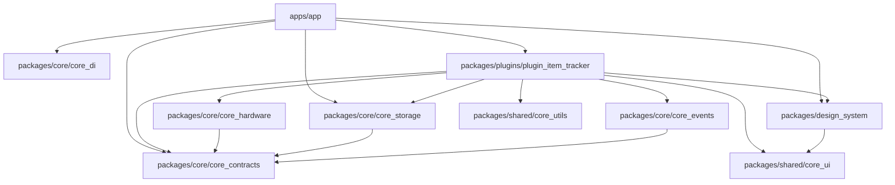
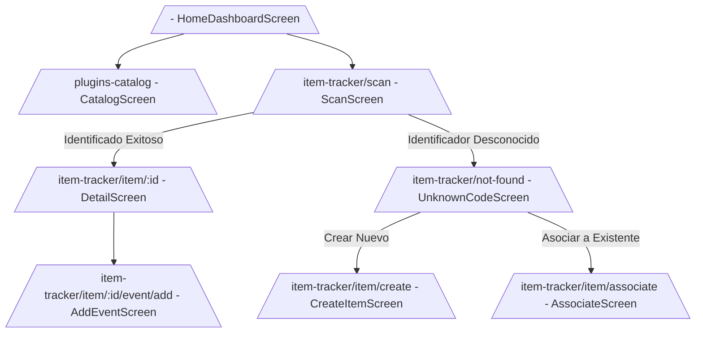
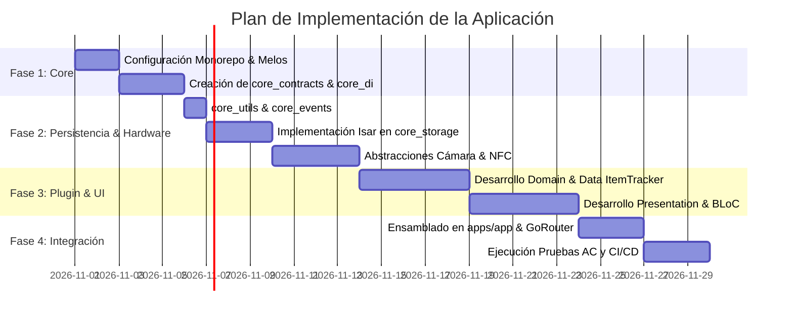

# SPEC.md - Especificación Técnica: Aplicación Flutter Modular de Utilidades del Hogar

---

## 1. Resumen Ejecutivo

Este documento define la especificación técnica completa, rigurosa y verificable para la **Aplicación Móvil de Utilidades del Hogar**, una plataforma multiplataforma (Android e iOS) construida con **Flutter** y **Dart**. 

El sistema utiliza una **Arquitectura Modular basada en Plugins** integrada en un **Monorepo administrado por Melos**, aplicando los principios de **Clean Architecture** y **CQRS/BLoC** para la gestión de estado. 

El documento actúa como contrato formal de arquitectura y **fuente única de verdad (Single Source of Truth)** para la implementación por parte de agentes de programación (Claude / Codex), garantizando que las decisiones sobre contratos entre paquetes, persistencia local, abstracción de hardware (NFC/Cámara), internacionalización y extensibilidad sean predecibles, libres de acoplamiento innecesario y preparadas para la evolución futura hacia la sincronización en la nube.

---

## 2. Alcance y Exclusiones

### 2.1. Alcance de la Primera Iteración (`v1.0.0`)
- **Infraestructura Monorepo**: Configuración completa de Melos, paquetes de abstracción core, sistema de diseño, utilidades y registro central de plugins.
- **Motor de Plugins**:
  - Registro compile-time de plugins.
  - Administración en runtime del ciclo de vida (Existencia $\rightarrow$ Disponibilidad $\rightarrow$ Activación $\rightarrow$ Inicialización).
  - Persistencia independiente del orden y estado de habilitación por el usuario.
- **Módulo de Identificación y Seguimiento de Objetos (`plugin_item_tracker`)**:
  - Abstracción de hardware para escaneo de **Códigos QR**, **Códigos de Barras** y lectura/escritura de **Tags NFC**.
  - Registro, edición y consulta de objetos físicos (`HouseholdItem`).
  - Asociación de **múltiples identificadores físicos** (`PhysicalIdentifier`) a un mismo objeto de dominio.
  - Gestión de historial de eventos técnicos y funcionales (`ItemEvent`) con estampas de tiempo en UTC.
  - Inserción y validación de metadatos dinámicos estructurados.
  - Manejo integral de estados límite: identificadores desconocidos, denegación de permisos de cámara/NFC y ausencia de hardware nativo.
- **Persistencia Local**: Base de datos NoSQL/Documental reactiva de alto rendimiento (**Isar DB**, vía el fork mantenido `isar_community`) aislada tras la capa de repositorios.
- **UI/UX, Accesibilidad e Internacionalización**:
  - Navegación declarativa modularizada mediante `GoRouter`.
  - Internacionalización centralizada y modular por paquete mediante `slang`.
  - Sistema de diseño de tokens y temas claro/oscuro.
  - Soporte semántico nativo con `Semantics` para lectores de pantalla (TalkBack / VoiceOver).

### 2.2. Exclusiones Explícitas (`v1.0.0`)
- Autenticación de usuarios, cuentas o sesiones de identidad.
- Sincronización remota, API REST/GraphQL o backend en la nube.
- Resolución de conflictos de datos concurrentes o multiusuario.
- Descarga y ejecución dinámica de código Dart en tiempo de ejecución (Over-The-Air / Dynamic Code Loading).
- Comunicación P2P local (Bluetooth/Wi-Fi Direct) entre dispositivos.

---

## 3. Decisiones Arquitectónicas Obligatorias

### 3.1. Plataformas y Aislamiento de Hardware
- **Plataformas objetivo**: Android (API nivel 24+ / Android 7.0) e iOS (iOS 15.0+).
  - Android sube de API 21 a **24** porque lo exige `nfc_manager` 4.x (`mobile_scanner` 7.x exige 23). Además hay que compilar contra la **API 37** (`compileSdk = 37`), que exige `permission_handler_android` 14.x.
  - iOS 15.0 es el mínimo de la plantilla de Flutter 3.47.
- **Configuración nativa de referencia**: `packages/core/core_hardware/example` (ver su README). En iOS los plugins se integran con **Swift Package Manager**, sin Podfile: `permission_handler` activa el permiso de cámara solo porque detecta `NSCameraUsageDescription` en el `Info.plist`. La lectura NFC requiere el entitlement `com.apple.developer.nfc.readersession.formats` (NDEF, TAG) y `NFCReaderUsageDescription`.
- **Abstracción de Hardware**: La invocación a hardware (Cámara y NFC) debe estar aislada detrás de contratos abstractos (`IdentifierScanner`) ubicados en `packages/core/core_hardware`. La capa de presentación y dominio **nunca** importará paquetes nativos directos (`mobile_scanner` o `nfc_manager`).
- **Diferencias y Limitaciones de Plataforma**:
  
| Capacidad / Escenario | Android | iOS | Comportamiento del Sistema |
| :--- | :--- | :--- | :--- |
| **NFC Background Reading** | Soportado mediante NDEF intents (`ACTION_NDEF_DISCOVERED`). | No soportado para apps de terceros sin Notificación Push/User Interaction. | La app requerirá inicio explícito de sesión de lectura en iOS. |
| **NFC Session UI** | Silencioso en SO; la app debe proveer la interfaz. | El SO despliega un diálogo nativo modal e ininterrumpible (`CoreNFC`). | La abstracción manejará el diálogo nativo en iOS y UI custom en Android. |
| **Permisos de Cámara** | Solicita en runtime (`android.permission.CAMERA`). | Requiere `NSCameraUsageDescription` en `Info.plist`. | Si se deniega, la app inhabilita la previsualización y sugiere registro manual. |
| **Dispositivo sin NFC** | `NfcAdapter.getDefaultAdapter() == null` | No presente en modelos inferiores a iPhone 7; iPad carece de NFC. | El plugin desactiva la opción NFC y permite QR/Barras/Entrada manual. |

### 3.2. Arquitectura Modular mediante Plugins

```text
+-------------------------------------------------------------------+
|                        1. EXISTENCIA                              |
|   El paquete del plugin está incluido en pubspec.yaml (Compile)   |
+-------------------------------------------------------------------+
                                  │
                                  ▼
+-------------------------------------------------------------------+
|                       2. DISPONIBILIDAD                           |
|  El dispositivo cumple capacidades físicas (ej. NFC presente)     |
+-------------------------------------------------------------------+
                                  │
                                  ▼
+-------------------------------------------------------------------+
|                       3. ACTIVACIÓN                               |
|   El usuario lo habilita en la UI (UserPluginPreference.isEnabled)|
+-------------------------------------------------------------------+
                                  │
                                  ▼
+-------------------------------------------------------------------+
|                     4. INICIALIZACIÓN                             |
| Invocación de HomePlugin.initialize() e inyección de dependencias|
+-------------------------------------------------------------------+
```

- **Compile-Time Discovery**: Todos los plugins conocidos se registran estáticamente en la aplicación principal (`apps/app/lib/app_module_registrar.dart`).
- **Run-Time Activation**: Un plugin registrado puede ser desactivado por el usuario. Al desactivarse:
  - Sus rutas de navegación se remueven o bloquean.
  - Sus Widgets en la pantalla de inicio no se renderizan.
  - Sus recursos locales y datos **permanecen intactos** en la base de datos.
  - Se invoca su método `dispose()` para liberar memoria y suscripciones.

### 3.3. Persistencia Local y Evolución Futura

- **Tecnología Elegida**: **Isar DB** a través de `isar_community` (fork mantenido con la misma API; `isar` 3.1.0+1 está abandonado y no compila con AGP 8).
- **Justificación**: Motor de base de datos NoSQL ultrarrápido para Flutter, tipo-seguro, con soporte nativo para `Streams` de consultas, índices compuestos y ejecución asíncrona mediante Isolate dedicado.
- **Estrategia Anti-Acoplamiento (Evolución Cloud)**:
  - **Identificadores Únicos**: Todas las entidades de dominio utilizan **UUID v4** (Strings estables de 128 bits) generados en el cliente. Prohibido el uso de autoincrementales numéricos para IDs de dominio.
  - **Estampa de Tiempo**: Todos los campos temporales se almacenan en **UTC** (`DateTime.now().toUtc()`).
  - **Patrón Repository**: Los casos de uso consumen abstracciones (`HouseholdItemRepository`). La implementación actual `IsarHouseholdItemRepository` convierte los modelos de dominio en colecciones Isar (`IsarHouseholdItem`). En el futuro, se podrá añadir una implementación remota (`HttpHouseholdItemRepository`) sin modificar un solo archivo del dominio ni de la presentación.

---

## 4. Investigación y Selección Tecnológica

| Tecnología / Paquete | Responsabilidad | Motivo de Selección | Capa / Paquete Consumidor | Enlace Oficial |
| :--- | :--- | :--- | :--- | :--- |
| **Flutter SDK (>=3.27.0)** | Framework UI | Estándar de la aplicación, alto rendimiento multiplataforma. | `apps/app`, `packages/*` | [flutter.dev](https://flutter.dev) |
| **Melos (>=8.0.0)** | Monorepo Tooling | Gestión de múltiples paquetes Dart, enlace de dependencias locales y ejecución de scripts. | Raíz del Proyecto | [melos.invertase.dev](https://melos.invertase.dev) |
| **flutter_bloc (>=8.1.3)** | Gestión de Estado | Predicibilidad de estados, separación entre eventos/UI, facilidad de pruebas unitarias. | `packages/plugins/*`, `apps/app` | [bloclibrary.dev](https://bloclibrary.dev) |
| **isar_community (3.3.2)** | Persistencia Local | Fork mantenido de Isar: NoSQL nativa de alto rendimiento con reactividad por `Streams`. Versión fijada: `isar_community_generator` 3.3.2 exige `analyzer` <11, lo que limita `build_runner` a 2.15.x. | `packages/core/core_storage` (reexporta la API) | [pub.dev/packages/isar_community](https://pub.dev/packages/isar_community) |
| **go_router (>=14.0.0)** | Navegación Declarativa | Integración declarativa basada en URLs, soporte nativo para sub-rutas de plugins y `ShellRoute`. | `apps/app`, `packages/core/core_contracts` | [pub.dev/packages/go_router](https://pub.dev/packages/go_router) |
| **mobile_scanner (>=7.4.0)** | Lectura QR / Barras | Basado en ML Kit (Android) y AVFoundation (iOS). Escaneo nativo rápido. | `packages/core/core_hardware` | [pub.dev/packages/mobile_scanner](https://pub.dev/packages/mobile_scanner) |
| **nfc_manager (>=4.2.0)** + **nfc_manager_ndef (>=1.1.0)** | Lectura / Escritura NFC | Abstracción de CoreNFC (iOS) y NfcAdapter (Android). En 4.x la lectura/escritura NDEF vive en `nfc_manager_ndef`. | `packages/core/core_hardware` | [pub.dev/packages/nfc_manager](https://pub.dev/packages/nfc_manager) |
| **permission_handler (>=13.0.0)** | Permisos en runtime | Distingue denegación temporal y permanente y abre los Ajustes de la app (§3.1, AC-06). | `packages/core/core_hardware` | [pub.dev/packages/permission_handler](https://pub.dev/packages/permission_handler) |
| **slang (>=4.0.0)** | Internacionalización | Tipo-seguro, soporta múltiples archivos JSON por paquete independientemente de `BuildContext`. | `packages/shared/core_ui` | [pub.dev/packages/slang](https://pub.dev/packages/slang) |
| **get_it (>=8.0.0)** | Service Locator | Inyección de dependencias liviana y rápida para resolver contratos de plugins y repositorios. | `packages/core/core_di` | [pub.dev/packages/get_it](https://pub.dev/packages/get_it) |
| **equatable (>=3.0.0)** | Igualdad por valor | Evita sobrescribir `==`/`hashCode` a mano en entidades, value objects y estados. | `packages/core/*`, `packages/plugins/*` | [pub.dev/packages/equatable](https://pub.dev/packages/equatable) |
| **uuid (>=4.4.0)** | Generación UUID | Creación de identificadores de dominio RFC4122 v4 independientes de la infraestructura. | `packages/shared/core_utils` | [pub.dev/packages/uuid](https://pub.dev/packages/uuid) |
| **rxdart (>=0.28.0)** | Programación Reactiva | Utilizado para el Bus de Eventos desacoplado entre módulos independientes. | `packages/core/core_events` | [pub.dev/packages/rxdart](https://pub.dev/packages/rxdart) |

---

## 5. Monorepo y Estructura de Carpetas

### 5.1. Árbol de Directorios del Monorepo

```text
home_utility_monorepo/
├── pubspec.yaml
├── analysis_options.yaml
├── tool/
│   └── verify_architecture.dart
├── apps/
│   └── app/                          # Aplicación principal ejecutable
│       ├── pubspec.yaml
│       ├── lib/
│       │   ├── main.dart
│       │   ├── app_module_registrar.dart
│       │   ├── navigation/
│       │   │   └── app_router.dart
│       │   └── home/
│       │       ├── bloc/
│       │       └── presentation/
│       └── test/
├── packages/
│   ├── core/                         # Infraestructura y Contratos Centrales
│   │   ├── core_contracts/           # Abstracciones de Plugins y Módulos
│   │   ├── core_storage/             # Motor e Interfaces Isar DB
│   │   ├── core_di/                  # Service Locator (GetIt)
│   │   ├── core_events/              # Bus de Eventos Global (RxDart)
│   │   └── core_hardware/            # Abstracciones de Cámara, QR y NFC
│   ├── design_system/                # Sistema de Diseño UI Centralizado
│   │   ├── lib/
│   │   │   ├── tokens/               # Colores, Tipografía, Espaciados
│   │   │   ├── theme/                # ThemeData Claro / Oscuro
│   │   │   └── components/           # Botones, Cards, Inputs, Modales
│   ├── shared/                       # Código Compartido Neutral
│   │   ├── core_ui/                  # Slang L10n helpers y componentes base
│   │   └── core_utils/               # Formatters, Extensions, UUID
│   └── plugins/                      # Módulos Funcionales Autónomos
│       └── plugin_item_tracker/      # Módulo de Seguimiento de Objetos
│           ├── pubspec.yaml
│           ├── lib/
│           │   ├── plugin_definition.dart # Definición e Inicialización
│           │   └── src/
│           │       ├── domain/       # Entities, ValueObjects, UseCases, Repositories
│           │       ├── data/         # Isar Collections, Mappers, ReposImpl
│           │       └── presentation/ # BLoCs, Cubits, Screens, Widgets
│           └── test/
```

### 5.2. Definición de Paquetes y Reglas de Dependencias



#### Reglas de Importación Strict:
1. **Regla 1**: Un paquete situado en `packages/plugins/*` **NUNCA** debe importar otro paquete de `packages/plugins/*`.
2. **Regla 2**: La capa de `Domain` dentro de cualquier paquete **NUNCA** debe importar código de Flutter (`package:flutter/...`) ni bibliotecas de persistencia (`package:isar/...`).
3. **Regla 3**: `packages/design_system` **SOLO** depende de Flutter SDK y de `packages/shared/core_ui`. Prohibido importar paquetes de infraestructura o plugins.
4. **Regla 4**: Solo `packages/core/core_hardware` importa `mobile_scanner`, `nfc_manager*` o `permission_handler`.

Las cuatro reglas se verifican con `melos run verify:arch` (`tool/verify_architecture.dart`).

### 5.3. Archivos de Configuración del Monorepo

#### `pubspec.yaml` raíz (Melos 8 + Dart pub workspaces)
Desde Melos 7 no existe `melos.yaml`: la configuración vive en la sección `melos:` del `pubspec.yaml` raíz y la lista de paquetes es la clave `workspace:` (admite globs desde Dart 3.11). Cada paquete declara `resolution: workspace`. Extracto (ver el archivo real para la lista completa de scripts):

```yaml
name: home_utility_monorepo
publish_to: none

environment:
  sdk: ^3.11.0

workspace:
  - packages/core/*
  # Se añaden apps/app, packages/design_system, packages/shared/* y
  # packages/plugins/* a medida que se crean.

dev_dependencies:
  flutter_lints: ^6.0.0
  melos: ^8.9.0
  test: ^1.28.0

melos:
  scripts:
    verify:            # analyze + verify:arch + test
    analyze:           # dart analyze --fatal-infos .
    test:              # test:flutter (flutter test) + test:dart (dart test) + test:tool
    verify:arch:       # dart run tool/verify_architecture.dart
    build:g:
      packageFilters:
        dependsOn: build_runner
      exec:
        command: dart run build_runner build --delete-conflicting-outputs
```

#### `analysis_options.yaml` (Raíz)
```yaml
include: package:flutter_lints/flutter.yaml

analyzer:
  language:
    strict-casts: true
    strict-raw-types: true
  errors:
    missing_required_param: error
    body_might_complete_normally: error # sustituye a missing_return (inexistente con null-safety)
    todo: ignore
  exclude:
    - "**/*.g.dart"
    - "**/*.i18n.json"

linter:
  rules:
    - always_declare_return_types
    - avoid_empty_else
    - avoid_relative_lib_imports
    - avoid_shadowing_type_parameters
    - avoid_types_as_parameter_names
    - await_only_futures
    - camel_case_extensions
    - camel_case_types
    - cancel_subscriptions
    - close_sinks
    - curly_braces_in_flow_control_structures
    - empty_catches
    - file_names
    - hash_and_equals
    - no_duplicate_case_values
    - prefer_conditional_assignment
    - prefer_const_constructors
    - prefer_is_empty
    - prefer_is_not_empty
    - prefer_iterable_whereType
    - unawaited_futures
    - unnecessary_const
    - unnecessary_new
    - unnecessary_null_aware_assignments
    - unnecessary_nullable_for_final_variable_declarations
    - unnecessary_string_interpolations
    - use_build_context_synchronously
```

---

## 6. Diseño del Sistema de Plugins

### 6.1. Contratos Base del Sistema (`packages/core/core_contracts`)

#### `HomePlugin.dart`
```dart
import 'package:flutter/material.dart';
import 'package:go_router/go_router.dart';

abstract class HomePlugin {
  /// Identificador único e inmutable del plugin (ej. 'item_tracker'). Se usa también como nombre del scope en core_di, clave de su preferencia guardada y namespace i18n
  String get id;

  /// Clave i18n para el nombre localizable
  String get nameKey;

  /// Clave i18n para la descripción localizable
  String get descriptionKey;

  /// Icono representativo en el dashboard
  IconData get icon;

  /// Versión del contrato semántico del plugin
  String get version;

  /// Indica si el dispositivo cumple las capacidades físicas del plugin
  /// (etapa de Disponibilidad). Los plugins con hardware lo consultan vía
  /// core_hardware. Un plugin no disponible no se inicializa ni se renderiza,
  /// pero su preferencia de usuario se conserva.
  Future<bool> isAvailable();

  /// Invocado durante el arranque si el plugin está activado por el usuario
  Future<void> initialize();

  /// Define las rutas declarativas expuestas por el plugin
  List<RouteBase> get routes;

  /// Renderiza el Widget interactivo para la pantalla de inicio
  Widget buildDashboardTile(BuildContext context);

  /// Invocado cuando el plugin es desactivado para liberar memoria
  Future<void> dispose();
}
```

#### `PluginRegistry.dart`
```dart
import 'home_plugin.dart';

class PluginRegistry {
  final Map<String, HomePlugin> _plugins = {};

  void register(HomePlugin plugin) {
    if (_plugins.containsKey(plugin.id)) {
      throw StateError('Error: Plugin duplicado detectado con ID "${plugin.id}".');
    }
    _plugins[plugin.id] = plugin;
  }

  HomePlugin? getPlugin(String id) => _plugins[id];

  List<HomePlugin> get allPlugins => List.unmodifiable(_plugins.values);
}
```

#### `UserPluginPreference.dart`
```dart
import 'package:equatable/equatable.dart';

class UserPluginPreference extends Equatable {
  final String pluginId;
  final bool isEnabled;
  final int sortOrder;

  const UserPluginPreference({
    required this.pluginId,
    required this.isEnabled,
    required this.sortOrder,
  });

  UserPluginPreference copyWith({
    bool? isEnabled,
    int? sortOrder,
  }) {
    return UserPluginPreference(
      pluginId: pluginId,
      isEnabled: isEnabled ?? this.isEnabled,
      sortOrder: sortOrder ?? this.sortOrder,
    );
  }

  @override
  List<Object?> get props => [pluginId, isEnabled, sortOrder];
}
```

#### `PluginPreferenceRepository` y `PluginLifecycleManager`
- `PluginPreferenceRepository` (`getAll`, `save`, `saveAll`, `watch`) es el contrato de persistencia de `UserPluginPreference`; su implementación vive en `core_storage`.
- `PluginLifecycleManager` aplica el ciclo de vida del §3.2 y expone `load()`, `setEnabled()`, `reorder()` y `disposeAll()`. Cada plugin termina en un `PluginStatus` (`unavailable`, `disabled`, `failed`, `ready`). Un plugin sin preferencia guardada se considera activado, con `sortOrder` igual a su posición de registro.

### 6.2. Algoritmo de Carga de la Pantalla de Inicio

1. El `HomeBloc` consulta las `UserPluginPreference` almacenadas en `core_storage`.
2. Solicita al `PluginRegistry` la lista de plugins conocidos.
3. Filtra la lista reteniendo únicamente aquellos cuyo `isEnabled == true`.
4. Ordena la lista resultante según el campo `sortOrder`.
5. Renderiza un `ReorderableListView` invocando `plugin.buildDashboardTile(context)` para cada uno.
6. Si la inicialización de un plugin falla (`plugin.initialize()`), captura la excepción, registra el error y muestra un Tile con estado de error local sin bloquear los demás plugins.

---

## 7. Clean Architecture

### 7.1. Definición de Capas

- **Presentation Layer**: Contiene Widgets, Screens, BLoCs/Cubits y ViewModels. Escucha estados e emite eventos. Depende exclusivamente de los Casos de Uso.
- **Domain Layer**: Contiene la lógica central del negocio: Entities, Value Objects, Repository Interfaces y Use Cases. Es código Dart puro (sin dependencias de Flutter o motores de BD).
- **Data Layer**: Contiene la implementación de los Repositorios, Data Sources (Isar DB, Hardware Adapters), DTOs (Data Transfer Objects) y Mappers bi-direccionales.

### 7.2. Diagrama de Inversión de Dependencias (Capa Data $\rightarrow$ Capa Domain)

```mermaid
graph LR
    subgraph Presentation
        UI[ItemTrackerScreen] --> Bloc[ItemTrackerBloc]
    end

    subgraph Domain
        Bloc --> UseCase[GetItemByIdentifierUseCase]
        UseCase --> RepInt[IHouseholdItemRepository]
    end

    subgraph Data
        RepImpl[IsarHouseholdItemRepository] ..|> RepInt
        RepImpl --> LocalDS[IsarLocalDataSource]
        RepImpl --> Mapper[ItemDataMapper]
    end
```

---

## 8. Primera Funcionalidad: Identificación de Objetos (`plugin_item_tracker`)

### 8.1. Abstracciones de Hardware (`packages/core/core_hardware`)

La cámara y el NFC tienen disponibilidad, permisos y UI distintos (un iPad tiene cámara pero no NFC), así que se modelan como dos escáneres más un servicio de permisos. Cada escáner pertenece a una pantalla: se crea al entrar y se libera con `dispose()` al salir (§16).

```dart
enum ScanType { qr, barcode, nfc }

class PhysicalScanResult extends Equatable {
  final String rawValue;   // Ya saneado según §8.2
  final ScanType type;
  final DateTime scannedAt; // Siempre UTC
}

enum HardwareStatus { available, disabled, unsupported }

enum ScanErrorCode {
  permissionDenied, hardwareUnsupported, hardwareDisabled,
  invalidValue, tagNotWritable, cancelled, unknown,
}

class ScanException implements Exception {
  final ScanErrorCode code;
  final String? message;
  final Object? cause;
}

abstract interface class IdentifierScanner {
  /// Broadcast. Los fallos llegan como errores ScanException; no se cierra hasta dispose().
  Stream<PhysicalScanResult> get scanStream;
  Future<HardwareStatus> checkHardware();
  Future<void> startScanning(); // Sin hardware/permiso emite ScanException, no lanza
  Future<void> stopScanning();
  Future<void> dispose();
}

abstract interface class CameraIdentifierScanner implements IdentifierScanner {
  /// Única vía para mostrar la cámara sin importar mobile_scanner en la presentación.
  Widget buildPreview(
    BuildContext context, {
    Widget Function(BuildContext context, ScanException error)? errorBuilder,
    WidgetBuilder? placeholderBuilder,
  });
}

abstract interface class NfcIdentifierScanner implements IdentifierScanner {
  /// Escribe value como registro NDEF Text en el próximo tag.
  Future<void> writeTag(String value);
}

enum HardwarePermissionStatus { granted, denied, permanentlyDenied, restricted }

abstract interface class HardwarePermissions {
  Future<HardwarePermissionStatus> cameraStatus();
  Future<HardwarePermissionStatus> requestCamera();
  Future<bool> openSettings();
}
```

- **Adaptadores**: `MobileScannerCameraScanner`, `NfcManagerScanner` y `PermissionHandlerPermissions`. NFC no requiere permiso en runtime.
- **Valor de un tag NFC**: el primer registro NDEF Text o URI legible; si no hay ninguno, el UID del tag en hexadecimal mayúscula (ej. `04A224B2C35E80`).
- **Dobles de prueba**: `package:core_hardware/testing.dart` expone `FakeCameraScanner`, `FakeNfcScanner` y `FakeHardwarePermissions`.

### 8.2. Reglas de Validación de Códigos y Contenido Escaneado
1. **Tratamiento de Datos**: Los valores leídos por escáneres (`rawValue`) se consideran **cadenas de texto no confiables**.
2. **Validación de Formato**:
   - Todo código escaneado se sanitiza eliminando caracteres de control no imprimibles (`\x00-\x1F` y `\x7F`). Un valor vacío tras sanear se rechaza (`ScanErrorCode.invalidValue`).
   - Si el valor es un URL externo (`https://...`), la aplicación no lo navegará automáticamente. Se almacenará como literal plano identificador.
   - Longitud máxima permitida para un `rawValue`: 2048 caracteres, medida tras sanear.
   - Implementación: `ScannedValueSanitizer.sanitize()` en `core_hardware`, aplicado por todos los adaptadores y también a los valores que se escriben en tags NFC.

---

## 9. Entidades y Modelos de Datos

### 9.1. Entidades de Dominio (`packages/plugins/plugin_item_tracker/lib/src/domain/entities`)

#### `HouseholdItem`
```dart
class HouseholdItem {
  final String id; // UUID v4
  final String name;
  final String description;
  final Map<String, dynamic> metadata;
  final DateTime createdAt;
  final DateTime updatedAt;

  HouseholdItem({
    required this.id,
    required this.name,
    required this.description,
    required this.metadata,
    required this.createdAt,
    required this.updatedAt,
  });
}
```

#### `PhysicalIdentifier`
```dart
/// Enum propio del dominio: el dominio no depende de core_hardware. La capa
/// data traduce ScanType -> IdentifierType con un mapper.
enum IdentifierType { qr, barcode, nfc }

class PhysicalIdentifier {
  final String id; // UUID v4
  final String rawValue;
  final IdentifierType type;
  final String itemId; // Foreign Key hacia HouseholdItem.id
  final DateTime boundAt;

  PhysicalIdentifier({
    required this.id,
    required this.rawValue,
    required this.type,
    required this.itemId,
    required this.boundAt,
  });
}
```

#### `ItemEvent`
```dart
class ItemEvent {
  final String id; // UUID v4
  final String itemId; // Foreign Key hacia HouseholdItem.id
  final String title;
  final String description;
  final DateTime timestamp; // Siempre UTC

  ItemEvent({
    required this.id,
    required this.itemId,
    required this.title,
    required this.description,
    required this.timestamp,
  });
}
```

### 9.2. Colecciones Isar para Persistencia Local (`packages/plugins/plugin_item_tracker/lib/src/data/models`)

```dart
import 'package:core_storage/core_storage.dart'; // Reexporta la API de Isar

part 'isar_household_item.g.dart';

@collection
class IsarHouseholdItem {
  Id isarId = Isar.autoIncrement;

  @Index(unique: true, replace: true)
  late String id; // UUID v4

  late String name;
  late String description;
  late String metadataJson; // Serialización String de Map<String, dynamic>
  
  @Index()
  late DateTime createdAt;
  late DateTime updatedAt;
}

@collection
class IsarPhysicalIdentifier {
  Id isarId = Isar.autoIncrement;

  @Index(unique: true, replace: true)
  late String id;

  @Index(composite: [CompositeIndex('type')], unique: true)
  late String rawValue; // Un identificador físico solo puede estar ligado a 1 objeto

  @Enumerated(EnumType.name)
  late IdentifierType type; // @Enumerated solo es válido sobre un enum

  @Index()
  late String itemId;

  late DateTime boundAt;
}

@collection
class IsarItemEvent {
  Id isarId = Isar.autoIncrement;

  @Index(unique: true, replace: true)
  late String id;

  @Index()
  late String itemId;

  late String title;
  late String description;

  @Index()
  late DateTime timestamp;
}
```

### 9.3. Ejemplo JSON Representativo de Dominio

```json
{
  "household_item": {
    "id": "f47ac10b-58cc-4372-a567-0e02b2c3d479",
    "name": "Caja de Almacenamiento Ropa Invierno",
    "description": "Ubicada en el estante superior del armario principal.",
    "metadata": {
      "color_etiqueta": "Azul",
      "peso_kg": 12.5,
      "fragil": false
    },
    "created_at": "2026-10-21T14:30:00.000Z",
    "updated_at": "2026-10-21T15:00:00.000Z",
    "identifiers": [
      {
        "id": "8c2be0b3-3a1d-4009-a78b-03c004278a22",
        "raw_value": "BOX-WINTER-2026-01",
        "type": "qr",
        "bound_at": "2026-10-21T14:30:00.000Z"
      },
      {
        "id": "1d98a0c2-550e-4b61-91a3-228741398bb1",
        "raw_value": "049000000443",
        "type": "barcode",
        "bound_at": "2026-10-21T14:35:00.000Z"
      }
    ],
    "events": [
      {
        "id": "77a80a22-26cb-4029-8e42-7efc92a9bda7",
        "title": "Cambio de Ubicación",
        "description": "Movida del garaje al altillo.",
        "timestamp": "2026-10-21T15:00:00.000Z"
      }
    ]
  }
}
```

---

## 10. Persistencia Local y Evolución Futura hacia la Nube

### 10.1. Mapeo y Transacciones en Isar
Las operaciones de escritura en la base de datos local deben ejecutarse dentro de bloques transaccionales explícitos expuestos por el `IsarLocalDataSource`:

```dart
Future<void> saveItemWithIdentifier(
  IsarHouseholdItem item, 
  IsarPhysicalIdentifier identifier,
) async {
  await isar.writeTxn(() async {
    // Isar genera putBy<Campo> para cada índice único: el campo `id` produce putById.
    await isar.isarHouseholdItems.putById(item);
    await isar.isarPhysicalIdentifiers.putById(identifier);
  });
}
```

### 10.2. Registro de Colecciones por Plugin
Isar exige conocer todos los esquemas al abrir la base de datos, pero las colecciones viven en la capa data de cada plugin y `core_storage` no puede depender de los plugins:

1. El plugin implementa `StorageSchemaContributor` (`core_storage`) además de `HomePlugin`, y expone sus esquemas en `storageSchemas`.
2. Al arrancar, la app reúne los contribuidores de **todos** los plugins registrados, incluidos los desactivados (de lo contrario Isar no abriría sus colecciones y se violaría AC-02), y llama a `LocalDatabase.open(directory:, contributors:)`.
3. `LocalDatabase` añade siempre los esquemas de infraestructura (`IsarPluginPreference`) y rechaza con `StateError` dos esquemas distintos con el mismo nombre de colección.

La implementación de `PluginPreferenceRepository` es `IsarPluginPreferenceRepository` (`core_storage`).

### 10.3. Preparación para Sincronización Remota Futura
Para garantizar que la adición de un servidor remoto no quiebre la arquitectura:
1. **Campos Inmutables**: `id` y `createdAt` jamás cambian tras su creación local.
2. **Soft Deletes**: Los elementos no se borran físicamente mediante `DELETE`, sino que se marcarán en el futuro mediante un flag opcional de infraestructura `isDeleted` para propagar el borrado a la nube.
3. **Control de Modificación**: El campo `updatedAt` se actualiza localmente en cada escritura. La futura sincronización utilizará este campo para el algoritmo de resolución de conflictos *Last-Write-Wins (LWW)*.

---

## 11. BLoC, Cubit y Comunicación Reactiva

### 11.1. Reglas de Elección entre BLoC y Cubit
- **Usar Cubit**: Para flujos de estado simples, lineales o de solo lectura (ej. Carga de detalles de un objeto, cambio de tema, edición de un formulario de texto).
- **Usar BLoC**: Para flujos asíncronos complejos, basados en eventos continuos, transiciones de escaneo en tiempo real (Cámara/NFC) o con necesidad de operadores de transformación (`debounceTime`, `switchMap`, `distinctUntilChanged`).

### 11.2. Bus de Eventos Inter-Módulo (`packages/core/core_events`)

```dart
import 'package:rxdart/rxdart.dart';

abstract class CrossPluginEvent {
  final DateTime emittedAt;
  CrossPluginEvent() : emittedAt = DateTime.now().toUtc();
}

class ItemCreatedCrossEvent extends CrossPluginEvent {
  final String itemId;
  final String itemName;

  ItemCreatedCrossEvent({required this.itemId, required this.itemName});
}

class EventBus {
  final PublishSubject<CrossPluginEvent> _subject = PublishSubject<CrossPluginEvent>();

  void publish(CrossPluginEvent event) {
    _subject.add(event);
  }

  // ofType(TypeToken) ya no existe en rxdart 0.28; whereType es el equivalente.
  Stream<T> on<T extends CrossPluginEvent>() => _subject.whereType<T>();

  Future<void> dispose() => _subject.close(); // publish() tras dispose se descarta
}
```

---

## 12. Navegación y Pantallas

### 12.1. Diagrama de Navegación del Sistema



### 12.2. Manejo de Excepciones de Navegación
- **Plugin Desactivado**: Si el usuario intenta navegar mediante Deep Link a una ruta de un plugin desactivado (`/item-tracker/...`), `GoRouter` intercepta la ruta en su `redirect` guard y la redirige a `/` mostrando un SnackBar informativo.

---

## 13. Internacionalización (i18n)

### 13.1. Estrategia con `slang`
- Cada paquete funcional gestiona su propio archivo de traducciones dentro de `lib/i18n/`.
- Idioma predeterminado: **Español (`es`)**. Idioma secundario: **Inglés (`en`)**.

#### Estructura de Archivo `strings.i18n.json` (`plugin_item_tracker`)
```json
{
  "item_tracker": {
    "title": "Seguimiento de Objetos",
    "scan_prompt": "Apunta al código QR/Barras o acerca el Tag NFC",
    "item_not_found": "Identificador no registrado",
    "events_count": "{count, plural, =0{Sin eventos} =1{1 evento registrado} other{# eventos registrados}}"
  }
}
```

- **Prevención de Colisiones**: Todas las claves dentro de un plugin **DEBEN** estar encerradas bajo un espacio de nombres correspondiente al ID del plugin (ej. `item_tracker`).

---

## 14. Accesibilidad (a11y)

1. **Labels Semánticos**: Ningún `IconButton` o control táctil debe carecer de la propiedad `tooltip` o un wrapper `Semantics(label: ...)`.
2. **Dimensiones de Objetivos Táctiles**: Todos los botones interactivos deben tener un área de toque mínima de **48x48 dp** según la directriz WCAG 2.1 AA.
3. **Escalado de Texto**: Todas las tipografías deben definirse utilizando unidades relativas para soportar el escalado del SO fino hasta un factor de **200%** sin desbordamiento de pantalla (uso de `SingleChildScrollView` en formularios).
4. **Anuncios para Lectores de Pantalla**: Al completar exitosamente un escaneo NFC o QR, se invoca `SemanticsService.sendAnnouncement(View.of(context), message, Directionality.of(context))` (`announce` está deprecado desde Flutter 3.35) para notificar la lectura al usuario ciego o de baja visión.

---

## 15. Sistema de Diseño y Temas

### 15.1. Design Tokens (`packages/design_system/lib/tokens`)

```dart
import 'package:flutter/material.dart';

abstract class AppColors {
  static const Color primary = Color(0xFF1E88E5);
  static const Color primaryDark = Color(0xFF1565C0);
  static const Color secondary = Color(0xFF26A69A);
  static const Color backgroundLight = Color(0xFFF8F9FA);
  static const Color backgroundDark = Color(0xFF121212);
  static const Color surfaceLight = Color(0xFFFFFFFF);
  static const Color surfaceDark = Color(0xFF1E1E1E);
  static const Color error = Color(0xD32F2F);
}

abstract class AppSpacing {
  static const double xs = 4.0;
  static const double sm = 8.0;
  static const double md = 16.0;
  static const double lg = 24.0;
  static const double xl = 32.0;
}

abstract class AppRadii {
  static const double small = 8.0;
  static const double medium = 12.0;
  static const double large = 16.0;
}
```

---

## 16. Seguridad, Permisos y Ciclo de Vida

1. **Uso de Cámara**: El controlador de la cámara (`MobileScannerController`) debe inicializarse únicamente al entrar a la pantalla `ScanScreen` y **debe ser destruido explícitamente (`dispose()`)** en el `dispose()` del Widget o BLoC para evitar fugas de memoria y drenaje de batería.
2. **Seguridad de Datos Locales**: Dado que la aplicación almacena datos sobre enseres del hogar, la base de datos Isar no almacena datos bancarios ni credenciales. Sin embargo, no se persisten rutas absolutas temporales ni buffers de cámara en el disco.
3. **Validación de URLs**: Si un código escaneado contiene un esquema URI `http://` o `https://`, se trata como texto estático sin autoejecutar descargas ni aperturas en el navegador sin confirmación explícita del usuario.

---

## 17. Pruebas y Calidad

### 17.1. Estrategia de Testing

- **Pruebas Unitarias (Domain/Data)**: Cobertura del 100% en `UseCases` y `Mappers`. Uso de `mocktail` para simular repositorios.
- **Pruebas de BLoC**: Uso de `bloc_test` para verificar emisiones de estado ante eventos.
- **Pruebas de Integración/Widget**: Verificación de renderizado de la pantalla `HomeDashboardScreen` y la correcta reacción ante plugins desactivados.

### 17.2. Comando de Verificación Completa
```bash
melos run analyze && melos run test
```

---

## 18. Criterios de Aceptación (`v1.0.0`)

| ID | Criterio de Aceptación | Precondiciones | Acciones | Resultado Esperado | Tipo de Prueba | Plataforma |
| :--- | :--- | :--- | :--- | :--- | :--- | :--- |
| **AC-01** | Registro de Plugins | Monorepo limpio. | Ejecutar `main.dart`. | `PluginRegistry` tiene registrado el plugin `item_tracker`. | Unit | Ambos |
| **AC-02** | Persistencia de Desactivación | App instalada en dispositivo. | Desactivar plugin de la lista en `/plugins-catalog` y reiniciar app. | El plugin no aparece en el Dashboard de Inicio; sus datos locales en Isar se conservan intactos. | Integración | Ambos |
| **AC-03** | Escaneo QR Exitoso | Objeto "Caja A" guardado con QR "QR-123". | Abrir cámara y escanear "QR-123". | La app navega automáticamente a la pantalla de detalle de "Caja A". | Widget/Manual | Ambos |
| **AC-04** | Identificador Desconocido | QR "UNKNOWN-99" no existe en BD. | Escanear "UNKNOWN-99". | Muestra pantalla de "Código No Encontrado" con opciones: "Crear Nuevo Objeto" o "Asociar a Existente". | Widget | Ambos |
| **AC-05** | Múltiples Identificadores | Objeto "Cama" creado. | Asociar QR "QR-BED" y Tag NFC "NFC-BED" al objeto "Cama". | La búsqueda de cualquiera de los dos identificadores retorna la misma entidad "Cama". | Unit/Domain | Ambos |
| **AC-06** | Hardware NFC No Disponible | Dispositivo sin sensor NFC o emulador. | Presionar botón de "Escanear NFC". | La app desactiva suavemente la opción NFC, muestra un mensaje descriptivo accesible y no produce un crash. | Widget | Ambos |

---

## 19. Orden de Implementación Incremental



---

## 20. Checklist Final de Verificación para Agente de Programación (Claude)

Antes de dar por completada la implementación de la primera iteración, verifica los siguientes puntos:

- [ ] ¿`melos bootstrap` resuelve el workspace (`pubspec.yaml` raíz) vinculando los paquetes locales sin errores de resolución de dependencias?
- [ ] ¿Ningún archivo dentro de `packages/plugins/plugin_item_tracker/lib/src/domain/` importa paquetes de Flutter SDK ni de Isar DB?
- [ ] ¿Todos los modelos de dominio generan su identificador primario utilizando la biblioteca `uuid` (UUID v4)?
- [ ] ¿La interfaz `IdentifierScanner` aísla completamente las librerías `mobile_scanner` y `nfc_manager` de la capa de presentación?
- [ ] ¿El catálogo de plugins persiste la preferencia del usuario (`UserPluginPreference`) separada de la definición estática del plugin (`HomePlugin`)?
- [ ] ¿Las lecturas y escrituras de fechas en la base de datos se realizan convirtiendo explícitamente la estampa de tiempo a UTC (`.toUtc()`)?
- [ ] ¿Todos los botones táctiles contienen propiedades `tooltip` o envoltorios `Semantics` localizados?
- [ ] ¿Se ejecutan las pruebas automatizadas con el comando `melos run test` y finalizan con éxito sin fallos?

---

## 21. Decisiones Pendientes de Validación Futura

1. **Cifrado de Base de Datos Local**: Evaluar en la versión `v1.1.0` la inclusión de la clave de cifrado Isar mediante `flutter_secure_storage` si se añaden datos con nivel alto de sensibilidad personal.
2. **Sincronización Cloud**: La arquitectura de repositorios actual admite la futura adición de un paquete `core_network` con soporte Dio / GraphQL sin requerir cambios estructurales en los plugins funcionales existentes.