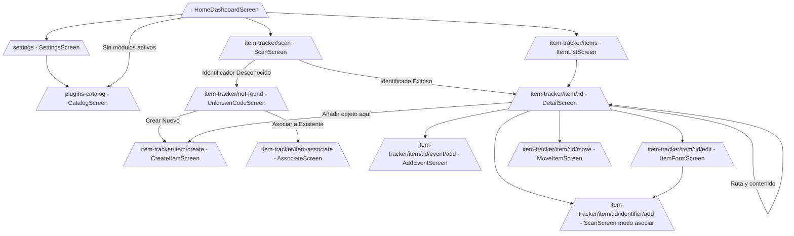
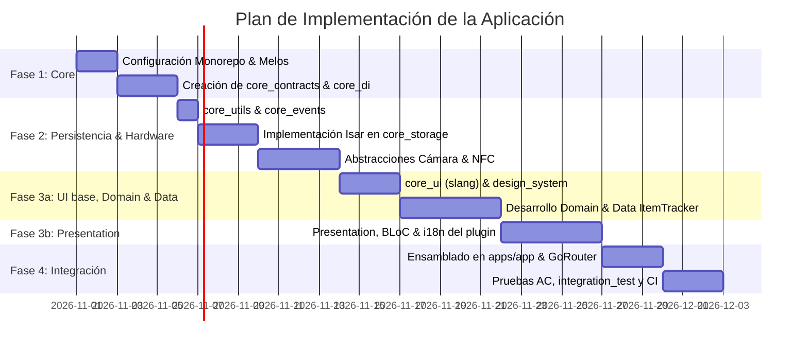

# SPEC.md - Especificación Técnica: Aplicación Flutter Modular de Utilidades del Hogar

---

## 1. Resumen Ejecutivo

Este documento define la especificación técnica completa, rigurosa y verificable para la **Aplicación Móvil de Utilidades del Hogar**, una plataforma multiplataforma (Android e iOS) construida con **Flutter** y **Dart**. 

El sistema utiliza una **Arquitectura Modular basada en Plugins** integrada en un **Monorepo administrado por Melos**, aplicando los principios de **Clean Architecture** y **CQRS/BLoC** para la gestión de estado. 

El documento actúa como contrato formal de arquitectura y **fuente única de verdad (Single Source of Truth)** para la implementación por parte de agentes de programación (Claude / Codex), garantizando que las decisiones sobre contratos entre paquetes, persistencia local, abstracción de hardware (NFC/Cámara), internacionalización y extensibilidad sean predecibles, libres de acoplamiento innecesario y preparadas para la evolución futura hacia la sincronización en la nube.

---

## 2. Alcance y Exclusiones

### 2.1. Alcance de la Primera Iteración (`v1.0.0`)
- **Infraestructura Monorepo**: Configuración completa de Melos, paquetes de abstracción core, sistema de diseño, utilidades y registro central de plugins.
- **Motor de Plugins**:
  - Registro compile-time de plugins.
  - Administración en runtime del ciclo de vida (Existencia $\rightarrow$ Disponibilidad $\rightarrow$ Activación $\rightarrow$ Inicialización).
  - Persistencia independiente del orden y estado de habilitación por el usuario.
- **Módulo de Identificación y Seguimiento de Objetos (`plugin_item_tracker`)**:
  - Abstracción de hardware para escaneo de **Códigos QR**, **Códigos de Barras** y lectura/escritura de **Tags NFC**.
  - Registro, edición y consulta de objetos físicos (`HouseholdItem`).
  - Asociación de **múltiples identificadores físicos** (`PhysicalIdentifier`) a un mismo objeto de dominio.
  - Gestión de historial de eventos técnicos y funcionales (`ItemEvent`) con estampas de tiempo en UTC.
  - Inserción y validación de metadatos dinámicos estructurados.
  - Manejo integral de estados límite: identificadores desconocidos, denegación de permisos de cámara/NFC y ausencia de hardware nativo.
- **Persistencia Local**: Base de datos NoSQL/Documental reactiva de alto rendimiento (**Isar DB**, vía el fork mantenido `isar_community`) aislada tras la capa de repositorios.
- **UI/UX, Accesibilidad e Internacionalización**:
  - Navegación declarativa modularizada mediante `GoRouter`.
  - Internacionalización centralizada y modular por paquete mediante `slang`.
  - Sistema de diseño de tokens y temas claro/oscuro.
  - Soporte semántico nativo con `Semantics` para lectores de pantalla (TalkBack / VoiceOver).

### 2.2. Exclusiones Explícitas (`v1.0.0`)
- Autenticación de usuarios, cuentas o sesiones de identidad.
- Sincronización remota, API REST/GraphQL o backend en la nube.
- Resolución de conflictos de datos concurrentes o multiusuario.
- Descarga y ejecución dinámica de código Dart en tiempo de ejecución (Over-The-Air / Dynamic Code Loading).
- Comunicación P2P local (Bluetooth/Wi-Fi Direct) entre dispositivos.

La sincronización entre dispositivos (P2P en la WiFi de casa, con resolución de conflictos) se añade después de `v1.0.0`: ver §10.4.

---

## 3. Decisiones Arquitectónicas Obligatorias

### 3.1. Plataformas y Aislamiento de Hardware
- **Plataformas objetivo**: Android (API nivel 24+ / Android 7.0) e iOS (iOS 15.0+).
  - Android sube de API 21 a **24** porque lo exige `nfc_manager` 4.x (`mobile_scanner` 7.x exige 23). Además hay que compilar contra la **API 37** (`compileSdk = 37`), que exige `permission_handler_android` 14.x.
  - iOS 15.0 es el mínimo de la plantilla de Flutter 3.47.
- **Configuración nativa de referencia**: `packages/core/core_hardware/example` (ver su README). En iOS los plugins se integran con **Swift Package Manager**; `isar_community_flutter_libs` aún no lo admite, así que en las apps que usan Isar Flutter genera un Podfile solo para él (modo mixto). En cualquier caso: `permission_handler` activa el permiso de cámara solo porque detecta `NSCameraUsageDescription` en el `Info.plist`. La lectura NFC requiere el entitlement `com.apple.developer.nfc.readersession.formats` (NDEF, TAG) y `NFCReaderUsageDescription`.
- **Abstracción de Hardware**: La invocación a hardware (Cámara y NFC) debe estar aislada detrás de contratos abstractos (`IdentifierScanner`) ubicados en `packages/core/core_hardware`. Las implementaciones nativas están en los adaptadores `packages/adapters/hardware_*`. La capa de presentación y dominio **nunca** importará paquetes nativos directos (`mobile_scanner` o `nfc_manager`).
- **Diferencias y Limitaciones de Plataforma**:
  
| Capacidad / Escenario | Android | iOS | Comportamiento del Sistema |
| :--- | :--- | :--- | :--- |
| **NFC Background Reading** | Soportado mediante NDEF intents (`ACTION_NDEF_DISCOVERED`). | No soportado para apps de terceros sin Notificación Push/User Interaction. | La app requerirá inicio explícito de sesión de lectura en iOS. |
| **NFC Session UI** | Silencioso en SO; la app debe proveer la interfaz. | El SO despliega un diálogo nativo modal e ininterrumpible (`CoreNFC`). | La abstracción manejará el diálogo nativo en iOS y UI custom en Android. |
| **Permisos de Cámara** | Solicita en runtime (`android.permission.CAMERA`). | Requiere `NSCameraUsageDescription` en `Info.plist`. | Si se deniega, la app inhabilita la previsualización y sugiere registro manual. |
| **Dispositivo sin NFC** | `NfcAdapter.getDefaultAdapter() == null` | No presente en modelos inferiores a iPhone 7; iPad carece de NFC. | El plugin desactiva la opción NFC y permite QR/Barras/Entrada manual. |

### 3.2. Arquitectura Modular mediante Plugins

```text
+-------------------------------------------------------------------+
|                        1. EXISTENCIA                              |
|   El paquete del plugin está incluido en pubspec.yaml (Compile)   |
+-------------------------------------------------------------------+
                                  │
                                  ▼
+-------------------------------------------------------------------+
|                       2. DISPONIBILIDAD                           |
|  El dispositivo cumple capacidades físicas (ej. NFC presente)     |
+-------------------------------------------------------------------+
                                  │
                                  ▼
+-------------------------------------------------------------------+
|                       3. ACTIVACIÓN                               |
|   El usuario lo habilita en la UI (UserPluginPreference.isEnabled)|
+-------------------------------------------------------------------+
                                  │
                                  ▼
+-------------------------------------------------------------------+
|                     4. INICIALIZACIÓN                             |
| Invocación de HomePlugin.initialize() e inyección de dependencias|
+-------------------------------------------------------------------+
```

- **Compile-Time Discovery**: Todos los plugins conocidos se registran estáticamente en la aplicación principal (`apps/app/lib/app_module_registrar.dart`) como una lista de `PluginFactory`. Cada factoría construye su plugin y registra sus traducciones (para que el catálogo muestre su nombre aunque esté desactivado). **Para añadir un plugin**: dependencia en `apps/app/pubspec.yaml` y una entrada en `appPluginFactories`.
- **Arranque** (`apps/app/lib/bootstrap.dart`): preferencias de la app (tema e idioma, de `shared_preferences`) → servicios base en `core_di` (`EventBus`, `IdGenerator`, `Clock`) → adaptadores elegidos (`appAdapters`, §10.2): cada uno abre sus recursos y registra sus contratos en el `ServiceLocator` → registro de plugins → `PluginLifecycleManager` con el `PluginPreferenceRepository` que registró un adaptador → carga de los plugins activos y disponibles.
- **Run-Time Activation**: Un plugin registrado puede ser desactivado por el usuario. Al desactivarse:
  - Sus rutas de navegación se remueven o bloquean.
  - Sus Widgets en la pantalla de inicio no se renderizan.
  - Sus recursos locales y datos **permanecen intactos** en la base de datos.
  - Se invoca su método `dispose()` para liberar memoria y suscripciones.

### 3.3. Persistencia Local y Evolución Futura

- **Tecnología Elegida**: **Isar DB** a través de `isar_community` (fork mantenido con la misma API; `isar` 3.1.0+1 está abandonado y no compila con AGP 8).
- **Justificación**: Motor de base de datos NoSQL ultrarrápido para Flutter, tipo-seguro, con soporte nativo para `Streams` de consultas, índices compuestos y ejecución asíncrona mediante Isolate dedicado.
- **Estrategia Anti-Acoplamiento (Evolución Cloud)**:
  - **Identificadores Únicos**: Todas las entidades de dominio utilizan **UUID v4** (Strings estables de 128 bits) generados en el cliente. Prohibido el uso de autoincrementales numéricos para IDs de dominio.
  - **Estampa de Tiempo**: Todos los campos temporales se almacenan en **UTC** (`DateTime.now().toUtc()`).
  - **Patrón Repository**: Los casos de uso consumen abstracciones (`HouseholdItemRepository`). La implementación actual, `IsarHouseholdItemRepository`, vive en el adaptador `item_tracker_isar` y convierte los modelos de dominio en colecciones Isar (`IsarHouseholdItem`). Otro motor o una implementación remota (`HttpHouseholdItemRepository`) será otro adaptador que pase la misma batería de tests de contrato: no cambia ningún archivo del dominio, del plugin ni de la presentación, solo la lista de adaptadores de la app (§10.2).

---

## 4. Investigación y Selección Tecnológica

| Tecnología / Paquete | Responsabilidad | Motivo de Selección | Capa / Paquete Consumidor | Enlace Oficial |
| :--- | :--- | :--- | :--- | :--- |
| **Flutter SDK (>=3.27.0)** | Framework UI | Estándar de la aplicación, alto rendimiento multiplataforma. | `apps/app`, `packages/*` | [flutter.dev](https://flutter.dev) |
| **Melos (>=8.0.0)** | Monorepo Tooling | Gestión de múltiples paquetes Dart, enlace de dependencias locales y ejecución de scripts. | Raíz del Proyecto | [melos.invertase.dev](https://melos.invertase.dev) |
| **flutter_bloc (>=8.1.3)** | Gestión de Estado | Predicibilidad de estados, separación entre eventos/UI, facilidad de pruebas unitarias. | `packages/plugins/*`, `apps/app` | [bloclibrary.dev](https://bloclibrary.dev) |
| **isar_community (3.3.2)** | Persistencia Local | Fork mantenido de Isar: NoSQL nativa de alto rendimiento con reactividad por `Streams`. Versión fijada: `isar_community_generator` 3.3.2 exige `analyzer` <11, lo que limita `build_runner` a 2.15.x. | Solo adaptadores: `packages/adapters/storage_isar` (reexporta la API) e `item_tracker_isar` | [pub.dev/packages/isar_community](https://pub.dev/packages/isar_community) |
| **go_router (>=14.0.0)** | Navegación Declarativa | Integración declarativa basada en URLs, soporte nativo para sub-rutas de plugins y `ShellRoute`. | `apps/app`, `packages/core/core_contracts` | [pub.dev/packages/go_router](https://pub.dev/packages/go_router) |
| **mobile_scanner (>=7.4.0)** | Lectura QR / Barras | Basado en ML Kit (Android) y AVFoundation (iOS). Escaneo nativo rápido. | `packages/adapters/hardware_mobile_scanner` | [pub.dev/packages/mobile_scanner](https://pub.dev/packages/mobile_scanner) |
| **nfc_manager (>=4.2.0)** + **nfc_manager_ndef (>=1.1.0)** | Lectura / Escritura NFC | Abstracción de CoreNFC (iOS) y NfcAdapter (Android). En 4.x la lectura/escritura NDEF vive en `nfc_manager_ndef`. | `packages/adapters/hardware_nfc_manager` | [pub.dev/packages/nfc_manager](https://pub.dev/packages/nfc_manager) |
| **permission_handler (>=13.0.0)** | Permisos en runtime | Distingue denegación temporal y permanente y abre los Ajustes de la app (§3.1, AC-06). | `packages/adapters/hardware_permission_handler` | [pub.dev/packages/permission_handler](https://pub.dev/packages/permission_handler) |
| **slang (>=4.0.0)** | Internacionalización | Tipo-seguro, soporta múltiples archivos JSON por paquete independientemente de `BuildContext`. | `packages/shared/core_ui` | [pub.dev/packages/slang](https://pub.dev/packages/slang) |
| **get_it (>=8.0.0)** | Service Locator | Inyección de dependencias liviana y rápida para resolver contratos de plugins y repositorios. | `packages/core/core_di` | [pub.dev/packages/get_it](https://pub.dev/packages/get_it) |
| **equatable (>=3.0.0)** | Igualdad por valor | Evita sobrescribir `==`/`hashCode` a mano en entidades, value objects y estados. | `packages/core/*`, `packages/plugins/*` | [pub.dev/packages/equatable](https://pub.dev/packages/equatable) |
| **uuid (>=4.4.0)** | Generación UUID | Creación de identificadores de dominio RFC4122 v4 independientes de la infraestructura. | `packages/shared/core_utils` | [pub.dev/packages/uuid](https://pub.dev/packages/uuid) |
| **share_plus (>=13.3.0)** | Compartir | Hoja de compartir del sistema para texto y archivos (exportar la lista de compras). | `packages/adapters/share_native` | [pub.dev/packages/share_plus](https://pub.dev/packages/share_plus) |
| **url_launcher (>=6.3.3)** | Abrir otras apps | Abre WhatsApp con `whatsapp://send` y comprueba si está instalado. | `packages/adapters/share_native` | [pub.dev/packages/url_launcher](https://pub.dev/packages/url_launcher) |
| **file_picker (>=13.1.0)** | Guardar archivos | Diálogo del sistema para elegir dónde guardar un archivo (`saveFile`). | `packages/adapters/share_native` | [pub.dev/packages/file_picker](https://pub.dev/packages/file_picker) |

---

## 5. Monorepo y Estructura de Carpetas

### 5.1. Árbol de Directorios del Monorepo

```text
home_utility_monorepo/
├── pubspec.yaml
├── analysis_options.yaml
├── tool/
│   └── verify_architecture.dart
├── apps/
│   └── app/                          # Aplicación principal ejecutable
│       ├── pubspec.yaml
│       ├── lib/
│       │   ├── main.dart
│       │   ├── app_module_registrar.dart
│       │   ├── navigation/
│       │   │   └── app_router.dart
│       │   └── home/
│       │       ├── bloc/
│       │       └── presentation/
│       └── test/
├── packages/
│   ├── core/                         # Infraestructura y Contratos Centrales
│   │   ├── core_contracts/           # Abstracciones de Plugins y Módulos
│   │   ├── core_di/                  # Service Locator (GetIt) y DependencyModule
│   │   ├── core_events/              # Contrato EventBus, StreamEventBus y EventSubscriptions
│   │   ├── core_hardware/            # Contratos de Cámara, QR, NFC y permisos
│   │   ├── core_app_shortcuts/       # Contrato AppShortcutService (accesos rápidos del icono)
│   │   ├── core_secrets/             # Contrato SecretStore (§10.4)
│   │   ├── core_share/               # Contrato ShareService (compartir, WhatsApp, guardar)
│   │   ├── core_spaces/              # Contratos de los espacios de datos (§10.4.10)
│   │   ├── core_sync/                # Contratos de la sincronización (§10.4)
│   │   └── sync_engine/              # Motor de sincronización y simulador (§10.4)
│   ├── adapters/                     # Adaptadores transversales (tecnologías reemplazables)
│   │   ├── app_shortcuts_quick_actions/ # AppShortcutService con quick_actions
│   │   ├── hardware_mobile_scanner/  # CameraIdentifierScanner con mobile_scanner
│   │   ├── hardware_nfc_manager/     # NfcIdentifierScanner con nfc_manager
│   │   ├── hardware_permission_handler/ # HardwarePermissions con permission_handler
│   │   ├── secret_store_secure_storage/ # SecretStore con flutter_secure_storage
│   │   ├── share_native/             # ShareService con share_plus, url_launcher y file_picker
│   │   ├── spaces_shared_preferences/ # Lista de espacios de datos con shared_preferences
│   │   ├── storage_isar/             # Base de datos Isar: IsarStorage, IsarFeature, IsarSpaceStorage
│   │   ├── sync_crypto_cryptography/ # SyncCipher con cryptography
│   │   ├── sync_isar/                # Estado de la sincronización en Isar (IsarFeature)
│   │   └── sync_lan/                 # SyncTransport en la red local (mDNS + WebSocket)
│   ├── contracts/                    # API pública de cada funcionalidad para otras (§11.2)
│   │   └── shopping_list_contract/   # Eventos y capacidades de la lista de compras
│   ├── design_system/                # Sistema de Diseño UI Centralizado
│   │   ├── lib/
│   │   │   ├── tokens/               # Colores, Tipografía, Espaciados
│   │   │   ├── theme/                # ThemeData Claro / Oscuro
│   │   │   └── components/           # Botones, Cards, Inputs, Modales
│   ├── shared/                       # Código Compartido Neutral
│   │   ├── core_ui/                  # Slang L10n helpers y componentes base
│   │   ├── core_utils/               # Formatters, Extensions, UUID
│   │   ├── hlc/                      # Reloj lógico híbrido (§10.4)
│   │   ├── list_export/              # Formateadores de listas para WhatsApp y Markdown
│   │   ├── qr_display/               # Widget de código QR (§10.4)
│   │   ├── recurrence/               # Recurrencia aproximada (entre X e Y días)
│   │   └── urgency/                  # Niveles de urgencia comunes
│   └── plugins/                      # Módulos Funcionales Autónomos
│       ├── shopping_list/            # Lista de compras (misma estructura que item_tracker, §9.5)
│       │   ├── shopping_list_domain/
│       │   ├── plugin_shopping_list/ # Con su example/
│       │   └── shopping_list_isar/
│       └── item_tracker/             # Carpeta de la funcionalidad (no es un paquete)
│           ├── item_tracker_domain/  # Dart puro: Entities, ValueObjects, Repository, errores
│           │   └── lib/testing.dart  # Tests de contrato y repositorio en memoria
│           ├── plugin_item_tracker/  # Módulo de Seguimiento de Objetos (HomePlugin)
│           │   ├── pubspec.yaml
│           │   ├── lib/
│           │   │   ├── plugin_definition.dart # Definición e Inicialización
│           │   │   └── src/
│           │   │       ├── domain/use_cases/ # Casos de uso
│           │   │       ├── i18n/     # Textos (slang)
│           │   │       └── presentation/ # BLoCs, Cubits, Screens, Widgets
│           │   ├── example/          # App de ejemplo del plugin
│           │   └── test/
│           └── item_tracker_isar/    # Adaptador Isar: Collections, Mappers, ReposImpl
│               ├── lib/
│               └── test/
```

### 5.2. Definición de Paquetes y Reglas de Dependencias

```mermaid
graph TD
    App[apps/app] --> CoreContracts[packages/core/core_contracts]
    App --> CoreDI[packages/core/core_di]
    App --> DesignSystem[packages/design_system]
    App --> PluginItemTracker[item_tracker/plugin_item_tracker]
    App --> StorageIsar[packages/adapters/storage_isar]
    App --> ItemTrackerIsar[item_tracker/item_tracker_isar]

    PluginItemTracker --> ItemTrackerDomain[item_tracker/item_tracker_domain]
    PluginItemTracker --> CoreContracts
    PluginItemTracker --> CoreHardware[packages/core/core_hardware]
    PluginItemTracker --> CoreEvents[packages/core/core_events]
    PluginItemTracker --> DesignSystem
    PluginItemTracker --> CoreUI[packages/shared/core_ui]
    PluginItemTracker --> CoreUtils[packages/shared/core_utils]

    ItemTrackerIsar --> ItemTrackerDomain
    ItemTrackerIsar --> StorageIsar
    StorageIsar --> CoreContracts
    StorageIsar --> CoreDI
    DesignSystem --> CoreUI

    App --> PluginShoppingList[shopping_list/plugin_shopping_list]
    App --> ShoppingListIsar[shopping_list/shopping_list_isar]
    App --> ShareNative[packages/adapters/share_native]
    PluginShoppingList --> ShoppingListDomain[shopping_list/shopping_list_domain]
    PluginShoppingList --> ShoppingListContract[packages/contracts/shopping_list_contract]
    PluginShoppingList --> CoreShare[packages/core/core_share]
    PluginShoppingList --> ListExport[packages/shared/list_export]
    ShoppingListDomain --> Recurrence[packages/shared/recurrence]
    ShoppingListDomain --> Urgency[packages/shared/urgency]
    ShoppingListContract --> Urgency
    ShoppingListContract --> CoreEvents
    ShoppingListIsar --> ShoppingListDomain
    ShoppingListIsar --> StorageIsar
    ShareNative --> CoreShare
```



`plugin_item_tracker` e `item_tracker_isar` no se conocen: se encuentran en el `ServiceLocator` a través del contrato `HouseholdItemRepository` de `item_tracker_domain`. Lo mismo con la lista de compras (`ShoppingListRepository`) y con `share_native` (`ShareService` de `core_share`). Otro plugin que quiera usar la lista de compras depende solo de `shopping_list_contract` (§11.2).

#### Roles de los paquetes

El verificador deduce el rol de cada paquete por su ruta y su nombre:

- **Host**: `apps/*` y las apps de `example/`. Componen paquetes y eligen adaptadores.
- **Plugin**: `packages/plugins/<funcionalidad>/plugin_<funcionalidad>`.
- **Dominio**: `packages/plugins/<funcionalidad>/<funcionalidad>_domain`. Dart puro.
- **Adaptador**: `packages/adapters/*` y `packages/plugins/<funcionalidad>/<funcionalidad>_<motor>` (`isar`, `sqflite`, `sqlite`, `drift`, `hive`, `objectbox`, `realm`, `sembast`).
- **Contrato**: `packages/contracts/*`. La API pública de una funcionalidad para las demás (§11.2). Dart puro.
- **Otros**: `core`, `shared` y `design_system`.

#### Reglas de Importación Strict:
1. **Regla 1**: Un paquete de una funcionalidad (`packages/plugins/<funcionalidad>/*`) **NUNCA** importa paquetes de otra funcionalidad. Los hosts sí, porque componen varias.
2. **Regla 2**: El dominio (los paquetes `<funcionalidad>_domain` y las carpetas `lib/src/domain/` o `lib/domain/` de cualquier paquete) **NUNCA** importa código de Flutter (`package:flutter*/...`, `dart:ui`) ni motores de base de datos.
3. **Regla 3**: `packages/design_system` **SOLO** depende de Flutter SDK y de `packages/shared/core_ui`. Prohibido importar paquetes de infraestructura o plugins.
4. **Regla 4**: Solo los adaptadores (`packages/adapters/hardware_*`) importan `mobile_scanner`, `nfc_manager*` o `permission_handler`.
5. **Regla 5**: Solo los adaptadores importan motores de base de datos (`isar*`, `sqflite*`, `sqlite3*`, `drift*`, `hive*`, `objectbox*`, `realm*`, `sembast*`).
6. **Regla 6**: Solo los hosts y otros adaptadores importan adaptadores. Un plugin nunca conoce su adaptador: pide el contrato al `ServiceLocator`.
7. **Regla 7**: Un adaptador o un dominio **NUNCA** importa el plugin.
8. **Regla 8**: Un contrato es Dart puro (sin `package:flutter*` ni `dart:ui`) y **NUNCA** importa plugins, dominios, otros paquetes de funcionalidades ni apps. Solo otros contratos y paquetes comunes (`core_events`, `urgency`…). Los adaptadores ya los prohíbe la regla 6.
9. **Regla 9**: Solo los adaptadores importan SDKs de plataforma: `share_plus*`, `url_launcher*`, `file_picker` y `path_provider*`.
10. **Regla 10**: Solo los adaptadores importan las librerías de la sincronización: descubrimiento en red (`bonsoir*`), criptografía (`cryptography*`) y almacén seguro (`flutter_secure_storage*`) (§10.4).

Las diez reglas se verifican con `melos run verify:arch` (`tool/verify_architecture.dart`, lógica en `tool/src/architecture_rules.dart`).

### 5.3. Archivos de Configuración del Monorepo

#### `pubspec.yaml` raíz (Melos 8 + Dart pub workspaces)
Desde Melos 7 no existe `melos.yaml`: la configuración vive en la sección `melos:` del `pubspec.yaml` raíz y la lista de paquetes es la clave `workspace:` (admite globs desde Dart 3.11). Cada paquete declara `resolution: workspace`. Extracto (ver el archivo real para la lista completa de scripts):

```yaml
name: home_utility_monorepo
publish_to: none

environment:
  sdk: ^3.11.0

workspace:
  - packages/core/*
  # Se añaden apps/app, packages/design_system, packages/shared/* y
  # packages/plugins/* a medida que se crean.

dev_dependencies:
  flutter_lints: ^6.0.0
  melos: ^8.9.0
  test: ^1.28.0

melos:
  command:
    bootstrap:
      hooks:
        post: melos run gen   # el código generado no se versiona
  scripts:
    verify:            # analyze + verify:arch + test
    analyze:           # dart run tool/analyze.dart
    test:              # test:flutter (flutter test) + test:dart (dart test) + test:tool
    verify:arch:       # dart run tool/verify_architecture.dart
    gen:               # gen:isar + gen:i18n
    gen:isar:
      packageFilters:
        dependsOn: build_runner
      exec:
        command: dart run build_runner build
    gen:i18n:
      packageFilters:
        fileExists: slang.yaml
      exec:
        command: dart run slang
```

- **Código generado**: los `*.g.dart` (Isar y slang) no se versionan. `melos bs` los genera al terminar, y `melos run gen` los regenera tras cambiar un modelo o un JSON de traducciones.
- **`build_runner` y apps de ejemplo**: un paquete con `build_runner` y `example/` necesita un `build.yaml` que excluya `example/**`. Si no, build_runner sigue `example/ios/.symlinks` hasta `~/.pub-cache` y borra archivos generados de otros paquetes.
- **`tool/analyze.dart`**: ejecuta `dart analyze` y falla con cualquier diagnóstico (como `--fatal-infos`) salvo los de las reglas en adopción gradual (`toleratedCodes`), que solo cuenta por proyecto. Hoy la lista está vacía: `always_specify_types` ya es obligatoria.
- **Versiones y CHANGELOG**: cada paquete y `apps/app` siguen [SemVer](https://semver.org/lang/es/) en la `version:` de su `pubspec.yaml` y llevan un `CHANGELOG.md` en su raíz (las apps de `example/`, `tool/` y la raíz no). Toda rama que cambie un paquete sube su versión y añade una entrada; el primer cambio a un paquete sin CHANGELOG lo crea. En `0.x.y`, un cambio incompatible sube el minor y cualquier otro el patch; en `apps/app` también sube el build (`+n`). Entre paquetes del workspace se usa `^x.y.z` (nunca `any`); si una subida deja fuera la restricción de un dependiente, la misma rama la actualiza en todos los `pubspec.yaml` que dependen del paquete. En un plugin, `HomePlugin.version` coincide con la versión del `pubspec.yaml`. Formato, basado en [Keep a Changelog](https://keepachangelog.com/es-ES/1.1.0/), con los tipos en este orden y omitiendo los vacíos:

```markdown
# Changelog

## 0.2.0 - 2026-10-24

### Añadido        <!-- funcionalidad nueva -->
- Reemplazo de traducciones con `LocalizationCoordinator.overrideTranslations`.

### Cambiado       <!-- cambios en algo que ya existía -->
- **Incompatible:** <qué cambia y cómo adaptarse>.

### Obsoleto       <!-- se eliminará en una versión futura -->
### Eliminado      <!-- lo que se quitó -->
### Corregido      <!-- errores arreglados -->
### Seguridad      <!-- vulnerabilidades corregidas -->

### Interno        <!-- refactors, tests o tooling sin cambio de comportamiento -->
- Tipos explícitos en todo el paquete.
```

#### `analysis_options.yaml` (Raíz)
```yaml
include: package:flutter_lints/flutter.yaml

analyzer:
  language:
    strict-casts: true
    strict-raw-types: true
  errors:
    missing_required_param: error
    body_might_complete_normally: error # sustituye a missing_return (inexistente con null-safety)
    todo: ignore
    always_specify_types: warning # obligatoria: tool/analyze.dart falla con cualquier diagnóstico
  exclude:
    - "**/*.g.dart"
    - "**/*.i18n.json"

linter:
  rules:
    - always_declare_return_types
    - always_specify_types
    - avoid_empty_else
    - avoid_relative_lib_imports
    - avoid_shadowing_type_parameters
    - avoid_types_as_parameter_names
    - await_only_futures
    - camel_case_extensions
    - camel_case_types
    - cancel_subscriptions
    - close_sinks
    - curly_braces_in_flow_control_structures
    - empty_catches
    - file_names
    - hash_and_equals
    - no_duplicate_case_values
    - prefer_conditional_assignment
    - prefer_const_constructors
    - prefer_is_empty
    - prefer_is_not_empty
    - prefer_iterable_whereType
    - unawaited_futures
    - unnecessary_const
    - unnecessary_new
    - unnecessary_null_aware_assignments
    - unnecessary_nullable_for_final_variable_declarations
    - unnecessary_string_interpolations
    - use_build_context_synchronously
```

---

## 6. Diseño del Sistema de Plugins

### 6.1. Contratos Base del Sistema (`packages/core/core_contracts`)

#### `HomePlugin.dart`
```dart
import 'package:flutter/material.dart';
import 'package:go_router/go_router.dart';

abstract class HomePlugin {
  /// Identificador único e inmutable del plugin (ej. 'item_tracker'). Se usa también como nombre del scope en core_di, clave de su preferencia guardada y namespace i18n
  String get id;

  /// Clave i18n para el nombre localizable
  String get nameKey;

  /// Clave i18n para la descripción localizable
  String get descriptionKey;

  /// Icono representativo en el dashboard
  IconData get icon;

  /// Versión del contrato semántico del plugin
  String get version;

  /// Indica si el dispositivo cumple las capacidades físicas del plugin
  /// (etapa de Disponibilidad). Los plugins con hardware lo consultan vía
  /// core_hardware. Un plugin no disponible no se inicializa ni se renderiza,
  /// pero su preferencia de usuario se conserva.
  Future<bool> isAvailable();

  /// Invocado durante el arranque si el plugin está activado por el usuario
  Future<void> initialize();

  /// Define las rutas declarativas expuestas por el plugin
  List<RouteBase> get routes;

  /// Renderiza el Widget interactivo para la pantalla de inicio
  Widget buildDashboardTile(BuildContext context);

  /// Invocado cuando el plugin es desactivado para liberar memoria
  Future<void> dispose();
}
```

#### `PluginRegistry.dart`
```dart
import 'home_plugin.dart';

class PluginRegistry {
  final Map<String, HomePlugin> _plugins = {};

  void register(HomePlugin plugin) {
    if (_plugins.containsKey(plugin.id)) {
      throw StateError('Error: Plugin duplicado detectado con ID "${plugin.id}".');
    }
    _plugins[plugin.id] = plugin;
  }

  HomePlugin? getPlugin(String id) => _plugins[id];

  List<HomePlugin> get allPlugins => List.unmodifiable(_plugins.values);
}
```

#### `UserPluginPreference.dart`
```dart
import 'package:equatable/equatable.dart';

class UserPluginPreference extends Equatable {
  final String pluginId;
  final bool isEnabled;
  final int sortOrder;

  const UserPluginPreference({
    required this.pluginId,
    required this.isEnabled,
    required this.sortOrder,
  });

  UserPluginPreference copyWith({
    bool? isEnabled,
    int? sortOrder,
  }) {
    return UserPluginPreference(
      pluginId: pluginId,
      isEnabled: isEnabled ?? this.isEnabled,
      sortOrder: sortOrder ?? this.sortOrder,
    );
  }

  @override
  List<Object?> get props => [pluginId, isEnabled, sortOrder];
}
```

#### `PluginPreferenceRepository` y `PluginLifecycleManager`
- `PluginPreferenceRepository` (`getAll`, `save`, `saveAll`, `watch`) es el contrato de persistencia de `UserPluginPreference`; la registra el adaptador de almacenamiento (`IsarPluginPreferenceRepository`, de `storage_isar`).
- `PluginLifecycleManager` aplica el ciclo de vida del §3.2 y expone `load()`, `setEnabled()`, `reorder()` y `disposeAll()`. Cada plugin termina en un `PluginStatus` (`unavailable`, `disabled`, `failed`, `ready`). Un plugin sin preferencia guardada se considera activado, con `sortOrder` igual a su posición de registro.

### 6.2. Algoritmo de Carga de la Pantalla de Inicio

1. El `HomeBloc` consulta las `UserPluginPreference` almacenadas mediante `PluginPreferenceRepository`.
2. Solicita al `PluginRegistry` la lista de plugins conocidos.
3. Filtra la lista reteniendo únicamente aquellos cuyo `isEnabled == true`.
4. Ordena la lista resultante según el campo `sortOrder`.
5. Renderiza un `ReorderableListView` invocando `plugin.buildDashboardTile(context)` para cada uno.
6. Si la inicialización de un plugin falla (`plugin.initialize()`), captura la excepción, registra el error y muestra un Tile con estado de error local sin bloquear los demás plugins.

**Implementación**: `PluginController` (`apps/app/lib/plugins`) envuelve a `PluginLifecycleManager` como `ChangeNotifier` y es la fuente única del estado de los plugins para el `HomeBloc`, el `CatalogCubit` y el guard del router.
- **Reordenar** (`onReorderItem`) persiste el nuevo `sortOrder`; los plugins que no se muestran conservan su orden relativo al final.
- **La tarjeta de error** ofrece *Reintentar*, que vuelve a llamar a `load()`.
- **Sin plugins activos**, un estado vacío lleva al catálogo.
- **Vista del inicio**: un botón de la barra superior, junto al engranaje, alterna entre la **lista** de tarjetas (la descrita arriba) y los **accesos rápidos**. Esta última es una grilla (`AppShortcutGrid`) con un icono y el título de cada plugin (`AppShortcutTile`, máximo dos líneas). Tiene 4 columnas en móvil y más en pantallas anchas.
  - Los plugins salen en el mismo orden que en la lista. En la grilla no se reordena.
  - Al final siempre hay un acceso **Añadir** que abre el catálogo, también cuando no hay plugins activos.
  - Al tocar un plugin con pantalla principal (implementa `HomePluginEntryRoute` de `core_contracts`, p. ej. la lista de compras) se abre esa pantalla (`entryRoute`). Si no la tiene, se abre su tarjeta (`buildDashboardTile`) en una hoja inferior con todas sus acciones (item_tracker, con «Escanear» y «Ver objetos»). La interfaz es opcional, así que añadirla no cambia `HomePlugin`.
  - Un plugin que falló se ve con colores de error y al tocarlo se reintenta.
  - La vista elegida es una preferencia de la app (`AppSettings.homeLayout`, clave `app.home_layout`), separada de las `UserPluginPreference`: cambiarla no modifica qué plugins están activos ni su orden.
- **Catálogo** (`/plugins-catalog`): un interruptor por plugin con su nombre y descripción traducidos (`LocalizationCoordinator.translate(nameKey)`). Los no disponibles no se pueden activar. Se abre desde Configuración.
- **Configuración** (`/settings`, engranaje de la barra de inicio):
  - **Apariencia**: tema *Sistema / Claro / Oscuro* (`ThemeMode` de `MaterialApp`).
  - **Idioma**: *Sistema / Español / English*, cada idioma con su propio nombre. Con *Sistema* la app sigue el idioma del dispositivo, también si cambia con la app abierta; con uno fijado, esos cambios se ignoran.
  - **Módulos**: abre el catálogo.
  - **Datos**: *Exportar / importar datos*, visible pero desactivado (*Próximamente*). Pendiente de diseño (§21).
  - **Persistencia** (tema, idioma y vista del inicio): `AppSettingsRepository` con `SharedPreferencesAppSettingsRepository`. Las preferencias de la app van en `shared_preferences`, separadas de la base de datos de los plugins; un valor que ya no se reconoce se lee como el valor por defecto. `AppSettingsController` (Cubit) aplica el idioma y guarda cada cambio; se cargan antes del primer frame.

---

## 7. Clean Architecture

### 7.1. Definición de Capas

- **Presentation Layer**: Contiene Widgets, Screens, BLoCs/Cubits y ViewModels. Escucha estados e emite eventos. Depende exclusivamente de los Casos de Uso.
- **Domain Layer**: Contiene la lógica central del negocio: Entities, Value Objects, Repository Interfaces y Use Cases. Es código Dart puro (sin dependencias de Flutter o motores de BD).
- **Data Layer**: Contiene la implementación de los Repositorios, Data Sources (Isar DB, Hardware Adapters), DTOs (Data Transfer Objects) y Mappers bi-direccionales.
- **Ubicación en una funcionalidad con datos**: las entidades y la interfaz del repositorio están en `<funcionalidad>_domain`; los casos de uso y la presentación, en `plugin_<funcionalidad>`; la capa data, en el adaptador `<funcionalidad>_<motor>`. El plugin no tiene capa data propia.

### 7.2. Diagrama de Inversión de Dependencias (Capa Data $\rightarrow$ Capa Domain)

```mermaid
graph LR
    subgraph Presentation
        UI[ItemTrackerScreen] --> Bloc[ItemTrackerBloc]
    end

    subgraph Domain
        Bloc --> UseCase[FindItemByIdentifier]
        UseCase --> RepInt[HouseholdItemRepository]
    end

    subgraph Data ["Data (item_tracker_isar)"]
        RepImpl[IsarHouseholdItemRepository] ..|> RepInt
        RepImpl --> LocalDS[IsarLocalDataSource]
        RepImpl --> Mapper[ItemDataMapper]
    end
```

---

## 8. Primera Funcionalidad: Identificación de Objetos (`plugin_item_tracker`)

### 8.1. Abstracciones de Hardware (`packages/core/core_hardware` y adaptadores `hardware_*`)

La cámara y el NFC tienen disponibilidad, permisos y UI distintos (un iPad tiene cámara pero no NFC), así que se modelan como dos escáneres más un servicio de permisos. Cada escáner pertenece a una pantalla: se crea al entrar y se libera con `dispose()` al salir (§16).

```dart
enum ScanType { qr, barcode, nfc }

class PhysicalScanResult extends Equatable {
  final String rawValue;   // Ya saneado según §8.2
  final ScanType type;
  final DateTime scannedAt; // Siempre UTC
}

enum HardwareStatus { available, disabled, unsupported }

enum ScanErrorCode {
  permissionDenied, hardwareUnsupported, hardwareDisabled,
  invalidValue, tagNotWritable, cancelled, unknown,
}

class ScanException implements Exception {
  final ScanErrorCode code;
  final String? message;
  final Object? cause;
}

abstract interface class IdentifierScanner {
  /// Broadcast. Los fallos llegan como errores ScanException; no se cierra hasta dispose().
  Stream<PhysicalScanResult> get scanStream;
  Future<HardwareStatus> checkHardware();
  Future<void> startScanning(); // Sin hardware/permiso emite ScanException, no lanza
  Future<void> stopScanning();
  Future<void> dispose();
}

abstract interface class CameraIdentifierScanner implements IdentifierScanner {
  /// Única vía para mostrar la cámara sin importar mobile_scanner en la presentación.
  Widget buildPreview(
    BuildContext context, {
    Widget Function(BuildContext context, ScanException error)? errorBuilder,
    WidgetBuilder? placeholderBuilder,
  });
}

abstract interface class NfcIdentifierScanner implements IdentifierScanner {
  /// Escribe value como registro NDEF Text en el próximo tag.
  Future<void> writeTag(String value);
}

enum HardwarePermissionStatus { granted, denied, permanentlyDenied, restricted }

abstract interface class HardwarePermissions {
  Future<HardwarePermissionStatus> cameraStatus();
  Future<HardwarePermissionStatus> requestCamera();
  Future<bool> openSettings();
}
```

- **Adaptadores**: `MobileScannerCameraScanner`, `NfcManagerScanner` y `PermissionHandlerPermissions`. NFC no requiere permiso en runtime.
- **Valor de un tag NFC**: el primer registro NDEF Text o URI legible; si no hay ninguno, el UID del tag en hexadecimal mayúscula (ej. `04A224B2C35E80`).
- **Dobles de prueba**: `package:core_hardware/testing.dart` expone `FakeCameraScanner`, `FakeNfcScanner` y `FakeHardwarePermissions`.

### 8.2. Reglas de Validación de Códigos y Contenido Escaneado
1. **Tratamiento de Datos**: Los valores leídos por escáneres (`rawValue`) se consideran **cadenas de texto no confiables**.
2. **Validación de Formato**:
   - Todo código escaneado se sanitiza eliminando caracteres de control no imprimibles (`\x00-\x1F` y `\x7F`). Un valor vacío tras sanear se rechaza (`ScanErrorCode.invalidValue`).
   - Si el valor es un URL externo (`https://...`), la aplicación no lo navegará automáticamente. Se almacenará como literal plano identificador.
   - Longitud máxima permitida para un `rawValue`: 2048 caracteres, medida tras sanear.
   - Implementación: `ScannedValueSanitizer.sanitize()` en `core_hardware`, aplicado por todos los adaptadores y también a los valores que se escriben en tags NFC.

---

## 9. Entidades y Modelos de Datos

### 9.1. Entidades de Dominio (`packages/plugins/item_tracker/item_tracker_domain/lib/src/entities`)

#### `HouseholdItem`
```dart
class HouseholdItem extends Equatable {
  final String id; // UUID v4, inmutable
  final String name;
  final String description;
  final ItemMetadata metadata; // Value object validado (§9.4)
  final DateTime createdAt; // UTC, inmutable
  final DateTime updatedAt; // UTC
  final String? parentId; // Objeto que lo contiene (§9.4); null si está suelto

  const HouseholdItem({
    required this.id,
    required this.name,
    required this.description,
    required this.metadata,
    required this.createdAt,
    required this.updatedAt,
    this.parentId,
  });
}
```

#### `PhysicalIdentifier`
```dart
/// Enum propio del dominio: el dominio no depende de core_hardware. Quien
/// escanea (el ScanBloc del plugin) traduce ScanType -> IdentifierType.
enum IdentifierType { qr, barcode, nfc }

class PhysicalIdentifier {
  final String id; // UUID v4
  final String rawValue;
  final IdentifierType type;
  final String itemId; // Foreign Key hacia HouseholdItem.id
  final DateTime boundAt;

  PhysicalIdentifier({
    required this.id,
    required this.rawValue,
    required this.type,
    required this.itemId,
    required this.boundAt,
  });
}
```

#### `ItemEvent`
```dart
/// Técnicos (los genera el sistema): created, updated, identifierBound,
/// identifierUnbound, moved, childAdded, childRemoved.
/// Funcional (lo escribe el usuario): note.
enum ItemEventKind { created, updated, identifierBound, identifierUnbound, moved, childAdded, childRemoved, note }

class ItemEvent extends Equatable {
  final String id; // UUID v4
  final String itemId; // Foreign Key hacia HouseholdItem.id
  final ItemEventKind kind;
  final String title;       // Ver §9.4: en los técnicos guarda datos, no texto traducido
  final String description;
  final DateTime timestamp; // Siempre UTC

  const ItemEvent({
    required this.id,
    required this.itemId,
    required this.kind,
    required this.title,
    required this.description,
    required this.timestamp,
  });
}
```

### 9.2. Colecciones Isar para Persistencia Local (`packages/plugins/item_tracker/item_tracker_isar/lib/src/models`)

```dart
import 'package:storage_isar/adapter.dart'; // Reexporta la API de Isar

part 'isar_household_item.g.dart';

@collection
class IsarHouseholdItem {
  Id isarId = Isar.autoIncrement;

  @Index(unique: true, replace: true)
  late String id; // UUID v4

  @Index(caseSensitive: false) // Búsqueda por nombre sin distinguir mayúsculas
  late String name;

  late String description;
  late String metadataJson; // Serialización JSON de ItemMetadata.values

  @Index()
  late DateTime createdAt;

  @Index() // Listado ordenado por última modificación
  late DateTime updatedAt;

  @Index() // Contenido de un objeto. Los registros anteriores se leen como null
  String? parentId;

  DateTime? deletedAt; // Borrado lógico (§10.3), UTC; null si está activo
}

@collection
class IsarPhysicalIdentifier {
  Id isarId = Isar.autoIncrement;

  @Index(unique: true, replace: true)
  late String id;

  // Un identificador físico activo solo puede estar ligado a 1 objeto. Sin
  // `replace`: un duplicado hace fallar la transacción (en nativo, IsarError con
  // el mensaje "Unique index violated"; en web, IsarUniqueViolationError). Los
  // quitados llevan su propio deletedId, así que no chocan con el activo.
  @Index(composite: [CompositeIndex('type'), CompositeIndex('deletedId')], unique: true)
  late String rawValue;

  @Enumerated(EnumType.name)
  late IdentifierType type; // @Enumerated solo es válido sobre un enum

  @Index()
  late String itemId;

  late DateTime boundAt;

  // Borrado lógico (§10.3): null si está activo; el propio id si se quitó.
  // Los registros anteriores se leen como activos.
  String? deletedId;
  DateTime? deletedAt; // UTC
}

@collection
class IsarItemEvent {
  Id isarId = Isar.autoIncrement;

  @Index(unique: true, replace: true)
  late String id;

  @Index(composite: [CompositeIndex('timestamp')]) // Historial por objeto, ordenado
  late String itemId;

  @Enumerated(EnumType.name)
  late ItemEventKind kind;

  late String title;
  late String description;

  late DateTime timestamp;
}
```

Isar devuelve las fechas en hora local: `ItemDataMapper` las convierte a UTC al leer y al escribir.

### 9.3. Ejemplo JSON Representativo de Dominio

```json
{
  "household_item": {
    "id": "f47ac10b-58cc-4372-a567-0e02b2c3d479",
    "name": "Caja de Almacenamiento Ropa Invierno",
    "description": "Ubicada en el estante superior del armario principal.",
    "metadata": {
      "color_etiqueta": "Azul",
      "peso_kg": 12.5,
      "fragil": false
    },
    "created_at": "2026-10-21T14:30:00.000Z",
    "updated_at": "2026-10-21T15:00:00.000Z",
    "identifiers": [
      {
        "id": "8c2be0b3-3a1d-4009-a78b-03c004278a22",
        "raw_value": "BOX-WINTER-2026-01",
        "type": "qr",
        "bound_at": "2026-10-21T14:30:00.000Z"
      },
      {
        "id": "1d98a0c2-550e-4b61-91a3-228741398bb1",
        "raw_value": "049000000443",
        "type": "barcode",
        "bound_at": "2026-10-21T14:35:00.000Z"
      }
    ],
    "events": [
      {
        "id": "77a80a22-26cb-4029-8e42-7efc92a9bda7",
        "title": "Cambio de Ubicación",
        "description": "Movida del garaje al altillo.",
        "timestamp": "2026-10-21T15:00:00.000Z"
      }
    ]
  }
}
```

---

### 9.4. Reglas de Negocio del Plugin

**Validación** (`ItemValidator`, `ItemMetadata`; errores `ItemValidationException` con `field` y `reason`):

| Campo | Regla |
| :--- | :--- |
| `name` | Obligatorio tras recortar espacios; máx. 120 caracteres. |
| `description` | Opcional; máx. 2000 caracteres. |
| `metadata` | Máx. 50 entradas. Claves `snake_case` (`^[a-z][a-z0-9_]*$`, máx. 64). Valores escalares JSON: `String` (máx. 500), `int`, `double` finito, `bool`. Sin `null`: para quitar un dato se elimina la clave. |
| `rawValue` | 1..2048 caracteres, sin caracteres de control. No se recorta (los espacios pueden ser parte del código). |
| Nota (`ItemEvent`) | Título obligatorio (máx. 120); descripción opcional (máx. 2000). |

**Identificadores**: un identificador (`rawValue` + `type`) ya ligado a **cualquier** objeto se **rechaza** con `IdentifierAlreadyBoundException(boundItemId)`; nunca se mueve directamente de un objeto a otro. El mismo valor con distinto tipo (p. ej. QR y código de barras) son identificadores distintos.
- **Añadir** desde el detalle o la edición del objeto: escaneo en modo asociar (`ScanBloc` con `bindToItemId`). Un código ya asociado se rechaza con el nombre de su objeto y la cámara no lo reintenta mientras siga en el encuadre.
- **Quitar** (`UnbindIdentifier`): borrado lógico (§10.3) con confirmación. Si el objeto no tiene ese identificador activo, `IdentifierNotFoundException`. Un valor quitado queda libre y se puede asociar a cualquier objeto.

**Borrar un objeto** (`DeleteItem`, desde el detalle): borrado lógico (§10.3) con confirmación. El objeto deja de aparecer en listados, búsquedas y escaneos, y sus identificadores activos quedan libres. Si contiene otros, el diálogo pregunta qué hacer con ellos (`DeletedContents`):
- `moveToParent`: su contenido directo pasa al contenedor del objeto borrado (o queda suelto si no estaba dentro de ninguno), con todo lo que contiene. Al subir de nivel nunca supera el máximo.
- `deleteAll`: se borra con él a cualquier profundidad (`ItemTree.descendantsOf`).

Todo va en una sola transacción (`HouseholdItemRepository.deleteItems`). El contenedor del objeto borrado registra `childRemoved`; con `moveToParent`, cada objeto que sale registra `moved` y el contenedor que lo recibe, `childAdded`. Al terminar, el detalle vuelve a la pantalla anterior (o al listado).

**Contenedores**: un objeto puede estar dentro de otro (`parentId`), p. ej. Mueble › Organizador › Cajón 2. Lo que contiene un objeto se mueve con él.
- **Niveles**: un objeto suelto está en el nivel 1. El máximo (`ContainmentPolicy.maxDepth`) es 5 y se configura con `--dart-define=ITEM_TRACKER_MAX_DEPTH=n` (un valor menor que 1 usa 5). Al mover se cuenta todo el subárbol: un organizador con cajones ocupa 2 niveles.
- **Errores**: meter un objeto en sí mismo o en algo que contiene lanza `ItemContainmentCycleException`; superar el máximo, `ItemContainmentTooDeepException(maxDepth)`.
- **Si se baja el límite** no se mueve nada: el contenedor que queda en el nivel máximo o por debajo y aún contiene objetos se marca como desbordado (`ContainmentPolicy.isOverflowing`) y el detalle lo avisa.
- **`ItemTree`** (`domain/hierarchy`) calcula ruta, nivel, contenido (ordenado por nombre), descendientes y altura a partir de la lista de objetos. Tolera contenedores inexistentes y ciclos.
- **Presentación**: el detalle muestra la ruta navegable, "Mover a…", "Sacar del contenedor", el contenido y "Añadir objeto aquí". "Mover a…" excluye el propio objeto y su contenido y muestra desactivados, con el motivo, el contenedor actual y los destinos que superarían el límite. La lista y la búsqueda muestran todos los objetos con su ruta.

**Eventos técnicos automáticos**: guardan datos, no texto traducido; la presentación compone el mensaje localizado.

| `kind` | Cuándo | `title` | `description` |
| :--- | :--- | :--- | :--- |
| `created` | Al crear el objeto | Nombre inicial | vacío |
| `updated` | Al editar, solo si algo cambió | vacío | Campos cambiados: `name,description,metadata` |
| `identifierBound` | Al asociar un identificador (también al crear) | `IdentifierType.name` | `rawValue` |
| `identifierUnbound` | Al quitar un identificador | `IdentifierType.name` | `rawValue` |
| `moved` | En el objeto, al cambiar de contenedor | Nombre del contenedor nuevo (vacío si sale de todos) | Su ID (vacío si sale de todos) |
| `childAdded` | En el contenedor, al entrar un objeto (también al crearlo dentro) | Nombre del objeto | Su ID |
| `childRemoved` | En el contenedor anterior, al salir un objeto o al borrarlo | Nombre del objeto | Su ID |
| `note` | El usuario añade una nota | Texto libre | Texto libre |

**Casos de uso** (`lib/src/domain/use_cases`): `CreateItem` (publica `ItemCreatedCrossEvent`; acepta `parentId`), `UpdateItem`, `MoveItem` (con `parentId: null` saca el objeto; si el contenedor no cambia no escribe nada), `DeleteItem`, `BindIdentifier`, `UnbindIdentifier`, `AddItemEvent`, `FindItemByIdentifier`, `GetItem`, `WatchItem`, `WatchItems`, `WatchItemTree`, `SearchItems`, `WatchItemIdentifiers`, `WatchItemEvents`. Reciben `IdGenerator` y `Clock` de `core_utils` por inyección, y `ContainmentPolicy` los que colocan objetos.

**Errores de dominio** (`sealed ItemTrackerException`): `ItemNotFoundException`, `IdentifierNotFoundException`, `IdentifierAlreadyBoundException`, `ItemContainmentCycleException`, `ItemContainmentTooDeepException` e `ItemValidationException`.

---

### 9.5. Lista de Compras (`packages/plugins/shopping_list`)

Plugin `ShoppingListPlugin`: ID `shopping_list` (scope DI, preferencia y namespace i18n) y rutas bajo `/shopping-list` (`/item/new`, `/item/:id/edit`, `/categories`). Sigue la estructura del §10.2: `shopping_list_domain`, `plugin_shopping_list` (con `example/`) y `shopping_list_isar`. Su API pública es `shopping_list_contract` (§11.2). La lista de tareas seguirá el mismo patrón (`task_list`, `/task-list`).

**Piezas compartidas** (paquetes Dart puros en `packages/shared/`, para compras y tareas):

- `urgency`: `Urgency.immediate` (hoy), `high` (la próxima vez), `normal` (por defecto) y `low` (cuando se pueda). `isUrgent` = inmediata o alta. El orden natural pone primero lo más urgente.
- `recurrence`: `Recurrence.between(min, max)` o `Recurrence.fixed(días)`, de 1 a 365. La ventana se abre a los `min` días de la última vez y se cierra al terminar el día `max`. Estados: `waiting`, `due` («toca») y `overdue` (atrasado). Si nunca se hizo, toca.
- `list_export`: modelo neutro `ExportDocument` y formateadores `WhatsAppFormatter` (`*negrita*`, viñetas) y `MarkdownFormatter` (escapa los caracteres especiales). Los textos los pone quien exporta.
- Las categorías **no** se comparten: cada plugin tiene las suyas. Se extraerán a un paquete común si tareas repite la misma lógica.

**Entidades**:

| Entidad | Campos |
| :--- | :--- |
| `ShoppingItem` | `id`, `name`, `notes`, `quantity` (texto libre, p. ej. «2 docenas»), `urgency`, `status` (`pending`/`purchased`), `categoryIds`, `recurrence?`, `lastPurchasedAt?`, `createdAt`, `updatedAt` |
| `ShoppingCategory` | `id`, `name?` (el del usuario), `defaultKey?` (las por defecto), `sortOrder` |
| `ShoppingPurchase` | `id`, `itemId`, `purchasedAt`: historial de compras |

**Validación** (`ShoppingValidator`; errores `ShoppingValidationException` con `field` y `reason`):

| Campo | Regla |
| :--- | :--- |
| `name` | Obligatorio tras recortar espacios; máx. 120 caracteres. |
| `notes` | Opcional; máx. 2000. |
| `quantity` | Opcional; máx. 40. |
| Nombre de categoría | Obligatorio; máx. 40; único sin distinguir mayúsculas (también frente al nombre traducido de las por defecto). |
| Recurrencia | Días entre 1 y 365; el mínimo no puede ser mayor que el máximo. |

**Estado que se muestra** (`ShoppingItem.stateAt(now)`): `overdue` (recurrente pasado su máximo), `pending` (normal pendiente o recurrente con la ventana abierta), `waiting` (recurrente que todavía no toca) y `purchased` (normal comprado). «Por comprar» = `overdue` + `pending`.

**Reglas**:

- **Categorías por defecto**: Comida, Aseo, Limpieza, Hogar y Farmacia. Se crean una sola vez (una marca evita volver a crearlas si el usuario las borra). Se pueden renombrar, reordenar y borrar; su nombre se traduce por `defaultKey` hasta que el usuario lo cambia.
- **Varias categorías**: un item puede tener varias. Al agrupar por categoría sale **una sola vez**, bajo la primera según el orden de las categorías, y las demás se muestran aparte (badges en la lista, entre paréntesis en el export). Sin categorías va a «Sin categoría», al final.
- **Borrar una categoría en uso**: se confirma indicando cuántos items la usan. Se quita de esos items (con `updatedAt` nuevo) en la misma transacción; conservan sus demás categorías.
- **Marcar como comprado** (`MarkShoppingItemPurchased`): guarda un `ShoppingPurchase` y `lastPurchasedAt`, y publica `ShoppingItemPurchased`. Un item normal pasa a `purchased`; uno recurrente sigue `pending` y espera a su ventana. Se puede deshacer (borra esa compra y restaura el item). Un item ya comprado no se vuelve a comprar.
- **Comprados**: se pueden volver a pendiente o borrar en bloque (con su historial). Los recurrentes nunca están comprados.
- **Historial**: se guarda para deshacer y, más adelante, para calcular cada cuánto se compra de verdad.
- **Filtrar y agrupar**: por categorías («cualquiera de», con o sin «Sin categoría»), urgencias y estados; agrupado por categoría o por urgencia. Dentro de un grupo: atrasado, pendiente, en espera y comprado; luego lo más urgente, y por nombre.
- **Exportar**: lo que hay que comprar (todo o lo filtrado), agrupado por categoría o por urgencia, con lo urgente resaltado y la fecha al pie. Por WhatsApp (avisa si no está instalado), como texto, o como `lista-de-compras.md` (compartir o guardar). Usa el `ShareService` de `core_share` que registre la app (`NativeShare` de `share_native`); sin él no se ofrece exportar.
- **Capacidades públicas** (`shopping_list_contract`): `ShoppingListQuery` (lo pendiente, lo más urgente primero) y `ShoppingListWriter.addItem`. `addItem` no duplica: reutiliza un pendiente con el mismo nombre (sin distinguir mayúsculas ni espacios) subiéndole la urgencia si hace falta, y vuelve a pendiente uno normal comprado.

**Casos de uso** (`lib/src/domain/use_cases`): `CreateShoppingItem`, `UpdateShoppingItem`, `GetShoppingItem`, `DeleteShoppingItems`, `MarkShoppingItemPurchased`, `UndoShoppingPurchase`, `MarkShoppingItemPending`, `ClearPurchasedShoppingItems`, `CreateShoppingCategory`, `RenameShoppingCategory`, `CountShoppingCategoryUsage`, `DeleteShoppingCategory`, `ReorderShoppingCategories`, `EnsureDefaultShoppingCategories`, `WatchShoppingList`, `WatchShoppingCategories` y `BuildShoppingExport`. `ShoppingListApi` implementa las capacidades públicas.

**Errores de dominio** (`sealed ShoppingListException`): `ShoppingItemNotFoundException`, `ShoppingCategoryNotFoundException`, `ShoppingCategoryNameTakenException` y `ShoppingValidationException`.

---

## 10. Persistencia Local y Evolución Futura hacia la Nube

### 10.1. Mapeo y Transacciones en Isar
Las operaciones de escritura en la base de datos local deben ejecutarse dentro de bloques transaccionales explícitos expuestos por el `IsarLocalDataSource`:

```dart
Future<void> saveItemWithIdentifier(
  IsarHouseholdItem item, 
  IsarPhysicalIdentifier identifier,
) async {
  await isar.writeTxn(() async {
    // Isar genera putBy<Campo> para cada índice único: el campo `id` produce putById.
    await isar.isarHouseholdItems.putById(item);
    await isar.isarPhysicalIdentifiers.putById(identifier);
  });
}
```

### 10.2. Adaptadores de Almacenamiento
El motor de base de datos es una tecnología reemplazable, así que solo lo conocen los adaptadores (reglas 5 y 6 del §5.2). Quien compone (la app o un ejemplo) solo los elige:

```dart
const List<DependencyModule> appAdapters = <DependencyModule>[
  IsarStorage(features: <IsarFeature>[ItemTrackerIsar()]),
];
```

1. `DependencyModule` (`core_di`) es el contrato de un paquete que registra implementaciones en el `ServiceLocator`. `bootstrapApp` llama a `register` de cada adaptador antes de crear los plugins.
2. `IsarStorage` (`storage_isar`) abre la base de datos (por defecto en la carpeta de documentos de la app) y registra `PluginPreferenceRepository` (`IsarPluginPreferenceRepository`). Después llama a `register` de cada `IsarFeature` con la base abierta.
3. Cada funcionalidad con datos tiene su adaptador Isar (`item_tracker_isar`), que implementa `IsarFeature`: aporta sus esquemas y registra sus repositorios con el tipo del contrato (`HouseholdItemRepository`). Importa la API de Isar desde `package:storage_isar/adapter.dart`.
4. Isar exige conocer todos los esquemas al abrir la base, así que `IsarStorage` lleva los `IsarFeature` de **todos** los plugins registrados, incluidos los desactivados (si no, Isar no abriría sus colecciones y se violaría AC-02). Añade siempre los esquemas de infraestructura (`IsarPluginPreference`) y rechaza con `StateError` dos esquemas distintos con el mismo nombre de colección.
5. La base se registra con `dispose`: `ServiceLocator.reset()` la cierra (tests y reinicios).
6. Los adaptadores conservan los nombres de colección y de base de datos que se usaban antes de separarlos, así que los datos ya guardados se siguen leyendo.

**Cambiar de motor** (p. ej. a SQLite): un `storage_<motor>` en `packages/adapters/` y un `<funcionalidad>_<motor>` por funcionalidad que pase la batería de contrato de su dominio (`householdItemRepositoryContract`). Fuera de ellos solo cambia la lista de adaptadores de quien compone.

### 10.3. Preparación para Sincronización Remota Futura
Para garantizar que la adición de un servidor remoto no quiebre la arquitectura:
1. **Campos Inmutables**: `id` y `createdAt` jamás cambian tras su creación local.
2. **Soft Deletes**: Los elementos no se borran físicamente mediante `DELETE`, sino que se marcan como borrados para propagar el borrado a la nube. **Implementado para los identificadores**: `deletedId` (el propio `id`, para que el índice único admita varios quitados del mismo valor) y `deletedAt` en UTC. **Y para los objetos**: `IsarHouseholdItem.deletedAt` en UTC; al borrar un objeto también se marcan sus identificadores activos. Las consultas y los streams solo devuelven los activos.
3. **Control de Modificación**: El campo `updatedAt` se actualiza localmente en cada escritura y es lo que ve el usuario. La sincronización no lo usa para resolver conflictos: cada campo lleva su propio HLC (§10.4.2).

### 10.4. Sincronización entre Dispositivos (fase 1: P2P en la red local)

Los dispositivos de un hogar (Android e iOS, normalmente más de tres y rara vez encendidos a la vez) comparten los datos de los plugins. Isar sigue siendo la fuente de verdad de cada dispositivo: la sincronización solo intercambia **registros de cambio**, y la app funciona igual sin red. En la fase 1 el único transporte es la WiFi de casa (mDNS y WebSocket entre las apps, solo con la app en primer plano). La fase 2 añadirá un buzón remoto (Supabase) como otro transporte, sin cambiar el motor (§21).

#### 10.4.1. Paquetes

| Paquete | Rol | Contenido |
| :--- | :--- | :--- |
| `packages/shared/hlc` | Dart puro | `Hlc` (tiempo de pared, contador y `deviceId`; orden total, serializable) y `HlcClock` (`now()`, `receive(remoto)`), que usa el `Clock` de `core_utils`. |
| `packages/core/core_sync` | contratos, Dart puro | Registro de cambio, vector de versiones, `SyncMetadata`, hogar, dispositivo y conflicto. Contratos `SyncTransport`, `SyncParticipant`, `SyncCipher`, `ChangeLog`, `SyncStateRepository` y `ConflictRepository`, con sus baterías y dobles en memoria en `testing.dart`. De él dependen los dominios. |
| `packages/core/core_secrets` | contrato, Dart puro | `SecretStore` (guardar, leer y borrar secretos por clave), con su batería y `InMemorySecretStore`. |
| `packages/core/sync_engine` | motor, Dart puro | `SyncEngine` (sesiones, fusión y gossip), bandeja de conflictos, servicio del hogar, planificador y estado. `SyncModule` (`DependencyModule`) lo compone a partir del locator. En `testing.dart`, el simulador de N dispositivos. |
| `packages/adapters/sync_crypto_cryptography` | adaptador | `SyncCipher` con [`cryptography`](https://pub.dev/packages/cryptography) en Dart puro. |
| `packages/adapters/secret_store_secure_storage` | adaptador | `SecretStore` con [`flutter_secure_storage`](https://pub.dev/packages/flutter_secure_storage) (Keychain y Keystore). |
| `packages/adapters/sync_lan` | adaptador | `SyncTransport` LAN: anuncio y descubrimiento con [`bonsoir`](https://pub.dev/packages/bonsoir); servidor y conexión con `dart:io` (`HttpServer`, `WebSocket`). |
| `packages/adapters/sync_isar` | `IsarFeature` | Log de cambios, vector, pares conocidos, hogar (sin la clave), conflictos e identidad del dispositivo. |
| `packages/shared/qr_display` | UI agnóstica | `AppQrCode` con [`qr`](https://pub.dev/packages/qr) y un `CustomPainter`. |

Quien compone la app solo elige adaptadores:

```dart
const List<DependencyModule> appAdapters = <DependencyModule>[
  IsarStorage(features: <IsarFeature>[ItemTrackerIsar(), ShoppingListIsar(), SyncIsar()]),
  SecureStorageSecrets(),
  CryptographySyncCipher(),
  LanSyncTransport(),
  // …compartir y hardware…
  SyncModule(), // toma del locator transportes, cifrador, estado y participantes
];
```

La regla 10 del §5.2 impide importar `bonsoir`, `cryptography` o `flutter_secure_storage` fuera de los adaptadores.

#### 10.4.2. Modelo de cambios

- **Registro de cambio** (inmutable):
  - `opId` (UUID v4), `householdId`, `deviceId`;
  - `seq`: contador del dispositivo, sin huecos;
  - colección y `entityId`;
  - los campos cambiados, cada uno con su valor;
  - el `Hlc`.
  - Puede incluir referencias a binarios por `sha256` (`BlobRef`), reservadas y sin implementar.
- **HLC:** orden total; el desempate final es por `deviceId`. Cada dispositivo avanza su reloj con los HLC que recibe.
- **Vector de versiones:** `{deviceId: último seq}`. Dice qué cambios tiene un dispositivo de cada autor, sirve para el gossip y, en la fase 2, como cursor del buzón remoto.
- **Metadatos en las entidades** (`SyncMetadata`, value object con `Equatable`):
  - un mapa campo → HLC;
  - para los campos que son conjuntos (p. ej. `categoryIds`), un HLC por elemento añadido o quitado;
  - `deletedAt` (tombstone) y `originDeviceId`.
- **Escritura local:** el repositorio estampa el HLC de los campos que cambian y escribe el registro de cambio **en la misma transacción** que la entidad. Los casos de uso no cambian. Se registra todo lo local, aunque el dispositivo aún no pertenezca a un hogar.
- **Aplicar cambios remotos** (`applyRemote`, atómico) es **idempotente y conmutativo**: el mismo conjunto de cambios, en cualquier orden y con duplicados, da el mismo estado. No genera registros nuevos (sin eco), salvo las resoluciones provisionales de conflictos (§10.4.4).
- **El formato permite:**
  - compactar el log más adelante, con una instantánea cuando todos los dispositivos conocidos confirmaron un tramo;
  - reutilizarlo para exportar e importar por archivo (§21.3).

#### 10.4.3. Fusión

- **Campos:** gana el valor con mayor HLC (*last-write-wins* por campo).
- **Conjuntos:** unión por elemento. Un elemento está presente si su último cambio (por HLC) fue añadirlo.
- **Borrado contra edición:** gana el borrado (`deletedAt`). Los repositorios filtran los borrados.
- **Datos de solo añadir:** se unen sin conflicto. Son los eventos del historial de `item_tracker` y las compras de `shopping_list`, salvo el caso de compra doble.
- **Gossip:** cada dispositivo guarda y reenvía los cambios de todos. Si A se sincroniza con B y luego B con C, C recibe los de A.

#### 10.4.4. Conflictos de reglas de negocio

Cuando la fusión rompería un invariante, el participante de la funcionalidad aplica una **resolución provisional determinista**: todos los dispositivos llegan a la misma, en cualquier orden. Además marca la entidad «en conflicto» y añade una entrada a la **bandeja de conflictos**. Desde la bandeja se puede confirmar la provisional («Resolver automáticamente») o elegir otra opción a mano. La resolución es a su vez un cambio que se sincroniza. Las reglas viven en cada `<funcionalidad>_domain`.

**item_tracker:**

| Situación | Resolución provisional | ¿Conflicto? |
| :--- | :--- | :--- |
| La misma etiqueta o código asociado a dos objetos | Se queda la asociación de HLC menor; la otra queda quitada | Sí, en los dos objetos |
| Movimientos concurrentes que forman un ciclo o superan `ContainmentPolicy` | Se revierte el movimiento de HLC mayor | Sí |
| Meter algo en un contenedor borrado, o borrarlo mientras otro mete algo | Gana el borrado; el contenido pasa al contenedor del borrado o queda suelto | Sí |
| Asociar un identificador a un objeto borrado | Gana el borrado; el identificador queda libre | No |

**shopping_list:**

| Situación | Resolución provisional | ¿Conflicto? |
| :--- | :--- | :--- |
| Dos compras del mismo item dentro de la misma ventana (antes de que vuelva a la lista) | Cuenta la de HLC menor | Sí («¿fueron dos compras?») |
| Deshacer una compra mientras otro edita el item | Deshacer es un cambio de campos con HLC nuevo; fusión normal por campo | No |
| Categoría borrada mientras otro la añade a un item | Gana el borrado; la referencia se ignora al leer | No |
| Categorías por defecto sembradas en varios dispositivos | Se unen por `defaultKey`: queda la de id menor y se remapean los items | No |
| Dos items o dos categorías con el mismo nombre | Quedan los dos | No |

Los borrados de la lista de compras (items, categorías, deshacer compra) pasan a ser tombstones.

#### 10.4.5. Participantes

- Cada funcionalidad que se sincroniza implementa `SyncParticipant`, con sus colecciones, su códec y sus reglas. La clase vive en su `_domain` y trabaja sobre el contrato de su repositorio, así que la prueban el repositorio en memoria y el de Isar.
- Su adaptador (`<funcionalidad>_isar`) la registra en el **scope raíz** al abrir la base. Por eso un plugin desactivado sigue recibiendo y guardando sus cambios, igual que `IsarStorage` abre los esquemas de todos los plugins.
- En la fase 1 participan `item_tracker` y `shopping_list`.
- **No se sincroniza:** qué plugins están activados (`PluginPreferenceRepository`), el tema ni el idioma (`AppSettingsRepository`).

#### 10.4.6. Hogar, emparejamiento y cifrado

- **Crear un hogar:** se generan `householdId` (UUID v4), una clave simétrica aleatoria de 256 bits y la época 1. La clave va al `SecretStore`, con un nombre por hogar (`sync.household.<householdId>.key`); el resto, a `SyncStateRepository`. El dispositivo que lo crea queda como creador.
- **Unirse:** se escanea con `CameraIdentifierScanner` un QR con `{versión, householdId, época, clave, creador, URL del relay (opcional, fase 2)}`. Si el usuario lleva al hogar los datos del espacio abierto (§10.4.10), se **fusionan**; no se sobrescribe nada.
- **Salir:** se borran la clave y el hogar; los datos locales se conservan.
- **Expulsar:** solo el dispositivo creador. Abre una época nueva con una clave nueva y muestra el QR nuevo, que el resto vuelve a escanear. El expulsado se queda en la época vieja y no recibe ni descifra nada nuevo.
- **Cifrado de extremo a extremo** (también en la LAN): AEAD XChaCha20-Poly1305 detrás de `SyncCipher`. Cada registro se cifra por separado (datos asociados: `householdId`, época, `deviceId` y `seq`), así que un relay podrá guardarlo sin leerlo. Las claves de cada uso se derivan con HKDF.
- **Autenticación de los pares:** antes de intercambiar nada, cada lado demuestra que conoce la clave con un desafío HMAC sobre los nonces de los dos.
- **Anuncio mDNS:** publica un identificador derivado de la clave de la época (HMAC truncado), nunca el `householdId`. Un dispositivo de otro hogar, o uno expulsado, no encuentra a los del hogar.
- `householdId` y `deviceId` son conceptos de primera clase, para que la autenticación futura (contraseña del hogar, administrador) sea otro adaptador. Ambas quedan fuera de esta fase.

#### 10.4.7. Transporte LAN y planificación

- `_hometasks._tcp` por mDNS y un servidor WebSocket en un puerto libre, solo con la app en primer plano.
- **Sesión:**
  1. desafío;
  2. intercambio de vectores (cifrado);
  3. cada lado envía, en lotes, los registros que le faltan al otro;
  4. cada lado los aplica y confirma.
- **Cuándo sincroniza:** al arrancar, al volver a primer plano, tras un cambio local (con debounce) y con «Sincronizar ahora». No se cuenta con el segundo plano.
- **Estado visible:** última sincronización, cambios pendientes, dispositivos visibles y errores. Se llega a él, a la bandeja y al emparejamiento desde Configuración.
- **Configuración nativa:**
  - iOS: `NSLocalNetworkUsageDescription` y `NSBonjourServices` (`_hometasks._tcp`). Si se deniega el permiso de red local, el estado lo explica.
  - Android: `INTERNET`, `CHANGE_WIFI_MULTICAST_STATE` y `ACCESS_NETWORK_STATE`. Las preferencias de `flutter_secure_storage` quedan fuera del backup automático.

#### 10.4.8. Migración

- Se conservan los nombres de colección y de base de datos.
- Los campos nuevos tienen valor por defecto.
- Al abrir la base, una migración idempotente (con una marca para no repetirla) hace dos cosas:
  - da a lo existente metadatos iniciales: HLC derivado de `updatedAt`, y el `deviceId` local como origen;
  - genera sus registros de cambio, para que viajen al unirse a un hogar.

#### 10.4.9. Pruebas

- **Simulador de convergencia** (`sync_engine/testing.dart`): N dispositivos con ediciones concurrentes, entregas desordenadas y duplicadas, y particiones de red, con semillas aleatorias reproducibles. Al final, todos tienen el mismo estado y se cumplen los invariantes.
- **Cobertura del 100 %:** `hlc`, el motor, los `_domain` (reglas de conflicto incluidas) y los mappers.
- **Baterías de contrato:** las pasan todas las implementaciones (transporte en memoria y LAN, cifrador, almacén de secretos, estado e Isar).
- **Tests de la app:** varios entornos de `AppHarness` conectados por el transporte en memoria.
- **Criterios de aceptación de la sincronización:**

| AC | Criterio |
| :--- | :--- |
| S-01 | Dos dispositivos en la misma WiFi con la app abierta convergen tras editar en ambos. |
| S-02 | Ediciones sin conexión en dos dispositivos convergen cuando vuelven a verse. |
| S-03 | Gossip: A↔B y después B↔C; C recibe los cambios de A sin haber visto nunca a A. |
| S-04 | Borrar en uno y editar en otro deja el dato borrado en todos. |
| S-05 | La misma etiqueta NFC asociada en dos dispositivos a objetos distintos cumple los invariantes, aparece en la bandeja de ambos y «Resolver automáticamente» converge en todos. |
| S-06 | Los movimientos concurrentes de contenedores nunca dejan un ciclo ni superan la profundidad máxima. |
| S-07 | Un dispositivo de otro hogar en la misma WiFi no ve ni descifra nada. |
| S-08 | Expulsar un dispositivo rota la clave; el expulsado deja de recibir cambios nuevos. |
| S-09 | Unirse a un hogar con datos locales los fusiona sin perder nada. |
| S-10 | Los datos de antes de la migración se siguen leyendo (AC-02). |
| S-11 | Plugins activados, tema e idioma no se sincronizan. |
| S-12 | Sin red, la app funciona igual. |
| S-13 | Un dispositivo en dos hogares: cada uno en su espacio, sus datos no se mezclan y cada hogar conserva su clave. |
| S-14 | Al actualizar desde una versión con un solo hogar, el primer espacio usa la base de siempre: datos, hogar y clave se conservan. |

#### 10.4.10. Varios hogares: espacios de datos

- **Espacio de datos** (`core_spaces`): un conjunto de datos con su propia base Isar (`IsarStorage(name: space.databaseName)`), local o de un hogar. Como mucho un espacio por hogar. El dispositivo usa uno, el activo; solo se sincroniza ese. Los demás se ponen al día por gossip cuando el usuario los abre.
- **Lista de espacios** (`DataSpaceDirectory`, adaptador `spaces_shared_preferences`): fuera de las bases, porque hay que leerla antes de abrir ninguna. Guarda la lista y el activo en una sola clave, así que nunca queda una lista sin activo.
- **Por espacio:** los datos de cada plugin, el log, el vector, el HLC, los conflictos, la identidad del dispositivo y los plugins activos (personales, no se sincronizan). **Por dispositivo:** la lista de espacios, los accesos rápidos del icono, el tema y el idioma.
- **Cambiar de espacio:** se para la sincronización, se liberan los plugins y se cierra la base; se abre la del otro espacio y solo entonces se marca como activo. Si no abre, se vuelve a abrir el anterior. La app vuelve a empezar en el inicio.
- **Crear un hogar o unirse:** si el espacio abierto es local, el usuario elige si lleva sus datos al hogar (el espacio pasa a ser del hogar) o empieza un espacio nuevo y vacío. Si ya es de un hogar, siempre se usa un espacio nuevo. Unirse a un hogar que ya tiene espacio abre ese espacio. Nunca se copian datos entre bases.
- **Borrar un espacio** (nunca el activo): primero se quita de la lista y después se borran su base (`DataSpaceStorage`, una base abierta no se borra) y la clave de su hogar. Si el proceso muere entre medias, el siguiente arranque borra las bases `space_*` que no están en la lista.
- **Migración:** el primer arranque crea un espacio sobre la base de siempre, sin copiar nada, y anota su hogar. La clave antigua (`sync.household.key`) se copia a la del hogar la primera vez que se lee y se conserva mientras sea la del hogar actual, para que volver a una versión anterior siga sincronizando.


---

## 11. BLoC, Cubit y Comunicación Reactiva

### 11.1. Reglas de Elección entre BLoC y Cubit
- **Usar Cubit**: Para flujos de estado simples, lineales o de solo lectura (ej. Carga de detalles de un objeto, cambio de tema, edición de un formulario de texto).
- **Usar BLoC**: Para flujos asíncronos complejos, basados en eventos continuos, transiciones de escaneo en tiempo real (Cámara/NFC) o con necesidad de operadores de transformación (`debounceTime`, `switchMap`, `distinctUntilChanged`).

### 11.2. Comunicación entre Plugins

Un plugin no puede importar otro (regla 1 del §5.2), pero pueden colaborar de forma indirecta: uno publica un hecho o expone una capacidad, y el otro la usa sin saber quién está al otro lado. Todo sigue funcionando si el otro plugin no está instalado o está desactivado.

| Necesidad | Mecanismo | Ejemplo |
| :--- | :--- | :--- |
| Avisar de un hecho que ya pasó, sin esperar respuesta, a cero o más oyentes | **Evento** en el `EventBus` | `ShoppingItemPurchased` |
| Pedir datos o una acción con un solo responsable, sabiendo si está disponible | **Capacidad**: interfaz del contrato registrada en el `ServiceLocator` | `ShoppingListQuery`, `ShoppingListWriter` |

No hay un bus de comandos aparte: un comando es una capacidad. Así la UI puede ocultar la acción («añadir a la compra») cuando el otro plugin no está, y la acción no se pierde.

#### Contratos (`packages/contracts/<funcionalidad>_contract`)

- Un paquete por funcionalidad que publica, con **todos** sus eventos, capacidades y los datos que cruzan la frontera (p. ej. `ShoppingItemSummary`, una vista mínima, nunca la entidad del dominio). Es Dart puro (regla 8).
- El plugin dueño publica sus eventos e implementa sus capacidades. Quien los usa depende solo del contrato, nunca del plugin.
- **Versionado**: SemVer del paquete de contrato. Un evento o una capacidad nuevos son una clase más (cambio compatible). Cambiar uno existente es un cambio incompatible y actualiza a sus consumidores en la misma rama. No hace falta `EventV2`: los eventos no se guardan ni viajan por red, y todo se compila junto.
- Un concepto que no es de ningún plugin («algo hace falta») irá a un paquete común de vocabulario de la casa cuando aparezca, no al contrato de un plugin.
- `testing.dart` del contrato trae la batería de las capacidades y un doble en memoria (`InMemoryShoppingList`) para los tests de quien lo usa.

#### Bus de eventos (`packages/core/core_events`)

- `EventBus` es un contrato (`publish`, `on<T>()`, `dispose`). `EventBus()` crea `StreamEventBus`, en memoria sobre un `StreamController` broadcast. Los eventos llegan de forma asíncrona y en orden, y solo a quien ya estaba suscrito: no se guardan ni se repiten.
- Los eventos extienden `CrossPluginEvent`, cuyo `emittedAt` viene del `Clock` de quien publica (en UTC).
- `testing.dart`: batería `eventBusContract` y `RecordingEventBus`, que guarda lo publicado.

#### Scopes y ciclo de vida

1. El `EventBus` va en el **scope raíz** y lo registra la app (`bootstrapApp`). Un plugin solo crea uno propio si no lo encuentra (tests).
2. Las capacidades las registra el plugin dueño en **su scope** (`pushScope(pluginId)`) dentro de `initialize()`. El `dropScope` de su `dispose()` las quita: un plugin desactivado deja de ofrecerlas sin hacer nada más.
3. **Resolver al usar**: el consumidor pide la capacidad al locator en el momento de usarla (`isRegistered<T>()` y después `get<T>()`), nunca la guarda en su `initialize()`. Así da igual el orden de inicialización y nada queda colgado si el otro se desactiva. Si falta, oculta la función o la degrada sin error.
4. **Suscripciones**: cada plugin las junta en un `EventSubscriptions` registrado en su scope con `dispose: (EventSubscriptions s) => s.cancelAll()`. `cancelAll` no espera los futuros de `cancel()` (bloquearían con el reloj simulado de `testWidgets`).
5. Un plugin desactivado se pierde los eventos de ese tiempo. Si necesita el estado actual, lo consulta con una capacidad al reinicializarse.
6. `PluginLifecycleManager` no cambia: las reglas 2 y 3 bastan.
7. Varios proveedores de la misma capacidad (p. ej. un export conjunto de compras y tareas) quedan para cuando exista el segundo: `ServiceLocator.getAll<T>()` con un registro por `pluginId`.

```dart
// Consumidor: «se acabó» → a la lista de compras, si está.
if (locator.isRegistered<ShoppingListWriter>()) {
  await locator.get<ShoppingListWriter>().addItem(ShoppingItemRequest(name: 'Pilas', urgency: Urgency.high));
}

// En initialize(), dentro de pushScope(id, init: ...):
final EventSubscriptions subscriptions = EventSubscriptions()
  ..listen<ShoppingItemPurchased>(locator.get<EventBus>(), onPurchased);
locator.registerSingleton(subscriptions, dispose: (EventSubscriptions s) => s.cancelAll());
```

La validación está en `apps/app/test/cross_plugin_communication_test.dart`: un plugin falso que solo conoce `shopping_list_contract` añade, consulta y escucha compras con la lista activa, sigue funcionando con ella desactivada y pierde sus suscripciones al desactivarse.

---

## 12. Navegación y Pantallas

### 12.1. Diagrama de Navegación del Sistema



- **Rutas planas y absolutas** (`ItemTrackerRoutes`), en el orden en que deben registrarse: `create` y `associate` antes de `item/:id`. `/item-tracker` redirige a `/item-tracker/scan`.
- El identificador viaja en query params (`?value=…&type=qr`), así que las pantallas funcionan como deep link; sin ellos, `not-found` y `associate` redirigen a `scan`.
- **Resultado por `pop`**: crear y asociar hacen `pop` con el ID del objeto, "no encontrado" lo reenvía, y `ScanScreen` abre el detalle. Al volver del detalle se pulsa atrás y se regresa a escanear, sin pantallas intermedias.
- **Añadidos respecto a la versión inicial**: listado de objetos (consulta del §2.1 y selección al asociar), edición de objetos (§2.1), añadir y quitar identificadores desde el objeto, y contenedores (§9.4).
- **Rutas de contenedores**: `create?parent=<id>` crea el objeto dentro de `<id>` y muestra su ruta; `item/:id/move` hace `pop` con el ID del contenedor elegido. `item/:id/identifier/add` hace `pop` con el ID del objeto.

- **`ScanBloc`**: solo existe el escáner del modo activo, y al cambiar de modo el anterior se libera sin bloquear la UI. Las lecturas de **cámara** iguales se ignoran durante 2 s (la cámara las repite mientras el código sigue en el encuadre, también al volver de otra pantalla). Las de **NFC** no se deduplican, porque cada una es una acción explícita del usuario. Mientras se busca o se navega, se ignoran las lecturas nuevas.
- **Entrada manual en `ScanScreen`**: un selector alterna entre **Escanear** y **Escribir código**. En modo escritura se oculta (y se libera) la cámara y se muestra un campo de texto con el selector de tipo (QR, código de barras, NFC); en modo escaneo se oculta el campo. Es la alternativa cuando se deniega la cámara o no hay NFC (§3.1, AC-06).

### 12.2. Definición del Plugin (`plugin_item_tracker/lib/plugin_definition.dart`)
`ItemTrackerPlugin implements HomePlugin`:
- **Del scope base de `core_di` toma**: `HouseholdItemRepository` (obligatorio; lo registra el adaptador que elige la app, p. ej. `ItemTrackerIsar`), `CameraIdentifierScanner` y `NfcIdentifierScanner` (factorías) y `HardwarePermissions` (obligatorios; los registran los adaptadores `hardware_*`; si falta alguno, `initialize()` falla), y `EventBus`, `IdGenerator` y `Clock` (opcionales; si faltan usa los suyos). No conoce el motor de base de datos ni los SDK de hardware.
- **`initialize()`**: registra su idioma en `LocalizationCoordinator` y crea su scope `item_tracker` con `ItemTrackerDependencies` (casos de uso, factorías de escáner y permisos). **`dispose()`** descarta ese scope.
- **Sustitutos por constructor**: factorías de escáner y `HardwarePermissions`, que reemplazan a los del locator, p. ej. por los fakes de `core_hardware/testing.dart`. En los tests se registra en el locator el `InMemoryHouseholdItemRepository` de `item_tracker_domain/testing.dart`, que `plugin_item_tracker/testing.dart` reexporta.
- `nameKey` / `descriptionKey` son rutas de slang (`itemTracker.title`). En la Fase 4 hay que decidir cómo resuelve el catálogo esas claves entre paquetes.
- **App de ejemplo**: `plugin_item_tracker/example` arranca igual que `apps/app` (servicios base, sus propios adaptadores, `IsarStorage(features: <IsarFeature>[ItemTrackerIsar()])` con una base separada de la de la app, e idioma del dispositivo) e incluye datos de ejemplo para recorrer AC-03/04/05 a mano.

### 12.3. Manejo de Excepciones de Navegación
- **Plugin Desactivado**: Si el usuario intenta navegar mediante Deep Link a una ruta de un plugin desactivado (`/item-tracker/...`), `GoRouter` intercepta la ruta en su `redirect` guard y la redirige a `/` mostrando un SnackBar informativo.
- **Implementación** (`PluginRouteGuard`):
  - El router incluye las rutas de **todos** los plugins registrados. El prefijo de cada plugin es el primer segmento de sus rutas (`/item-tracker`), así que el contrato `HomePlugin` no cambia.
  - Solo se abren las rutas de plugins en estado `ready`. Los `failed` también se bloquean, porque sus dependencias no están registradas, y muestran otro aviso.
  - El router se reevalúa con cada cambio del `PluginController` (`refreshListenable`).
- **Cambio de idioma con la app abierta**: los textos de slang son globales y las páginas abiertas no se enteran del cambio. `LanguageScope` (`core_ui`) expone el idioma, y el router envuelve el contenido de cada ruta en `LanguageRebuilder`, que lo vuelve a montar al cambiar el idioma sin tocar la pila de navegación. La app sigue el idioma del sistema (`didChangeLocales`) salvo que el usuario haya fijado uno en Configuración.

---

## 13. Internacionalización (i18n)

### 13.1. Estrategia con `slang`
- Cada paquete gestiona sus traducciones en `lib/src/i18n/` (`es.i18n.json`, `en.i18n.json`) con un `slang.yaml` propio y las genera con la CLI (`dart run slang`), sin `build_runner`.
- Configuración común de `slang.yaml`: `base_locale: es`, `key_case: camel`, `string_interpolation: braces` (`{name}`; por defecto slang usa `$name`), `lazy: false` (la carga diferida solo aporta en web e impide cambiar de idioma de forma síncrona) y un `enum_name`/`class_name`/`translate_var` propios por paquete para evitar colisiones.
- Idioma predeterminado: **Español (`es`)**. Idioma secundario: **Inglés (`en`)**.
- **Coordinación**: `LocalizationCoordinator` (`core_ui`) mantiene el mismo idioma en todos los paquetes. Cada paquete se registra con `register(packageName, applier)` y la app solo llama a `setLanguage(code)`. También expone `supportedLocales` y `localizationsDelegates` (Material/Cupertino/Widgets de `flutter_localizations`) para `MaterialApp`.
- Textos comunes (`Cancelar`, `Guardar`, `Reintentar`…): `commonStrings.common.*` de `core_ui`.

#### Estructura de Archivo `es.i18n.json` (`plugin_item_tracker`)
```json
{
  "item_tracker": {
    "title": "Seguimiento de Objetos",
    "scan_prompt": "Apunta al código QR/Barras o acerca el Tag NFC",
    "item_not_found": "Identificador no registrado",
    "events_count(plural)": {
      "zero": "Sin eventos",
      "one": "1 evento registrado",
      "other": "{n} eventos registrados"
    }
  }
}
```
Slang no usa la sintaxis ICU (`{count, plural, ...}`): los plurales se declaran con el modificador `(plural)` y el parámetro `n`.

- **Prevención de Colisiones**: Todas las claves dentro de un plugin **DEBEN** estar encerradas bajo un espacio de nombres correspondiente al ID del plugin (ej. `item_tracker`).

### 13.2. Textos inyectados por quien consume los paquetes
Quien consume los paquetes (`apps/app` y las apps de ejemplo) define **todos** sus textos visibles. Cada paquete conserva sus JSON como contrato de claves y como respaldo.
- **Orden de búsqueda:** el texto que inyecta el consumidor y, solo si falta, el del JSON del paquete. Los tests impiden que falte alguno.
- **Archivos:** `assets/i18n/<paquete>/<idioma>.json` en cada consumidor, donde `<paquete>` es el nombre con que se registra en `LocalizationCoordinator` (`core_ui`, `item_tracker`). Siguen la estructura de los JSON del paquete y llevan **todas sus claves**.

  | Consumidor | Paquetes que inyecta |
  |---|---|
  | `apps/app` | `core_ui`, `item_tracker` |
  | `plugin_item_tracker/example` | `core_ui`, `item_tracker` |
  | `design_system/example` | `core_ui` |
- **Mecanismo:** cada paquete activa `translation_overrides: true` en su `slang.yaml` y pasa `override:` al registrarse. El consumidor llama al arrancar a `injectTranslations(localization, bundle: rootBundle, packages: injectedTranslationPackages)` (core_ui), que lee los assets y los pasa a `LocalizationCoordinator.overrideTranslations`. Se puede llamar antes de que los paquetes se registren. El consumidor nunca usa el slang de otro paquete directamente.
- **Límites:** solo idiomas soportados (`es`, `en`). Una clave nueva primero se añade al paquete, porque su código la usa, y después a cada consumidor. Un archivo inválido se ignora en ejecución y el paquete muestra sus propios textos.
- **Validación:** slang no comprueba los textos inyectados al compilar. Cada consumidor tiene `test/injected_translations_test.dart`, que con `translationProblems` de `package:core_ui/testing.dart` exige que cada archivo tenga exactamente las claves del JSON del paquete, con el mismo tipo y los mismos parámetros (`{name}`): falla si falta una clave, sobra una o cambian sus parámetros.

---

## 14. Accesibilidad (a11y)

1. **Labels Semánticos**: Ningún `IconButton` o control táctil debe carecer de la propiedad `tooltip` o un wrapper `Semantics(label: ...)`.
2. **Dimensiones de Objetivos Táctiles**: Todos los botones interactivos deben tener un área de toque mínima de **48x48 dp** según la directriz WCAG 2.1 AA.
3. **Escalado de Texto**: Todas las tipografías deben definirse utilizando unidades relativas para soportar el escalado del SO fino hasta un factor de **200%** sin desbordamiento de pantalla (uso de `SingleChildScrollView` en formularios).
4. **Anuncios para Lectores de Pantalla**: Al completar exitosamente un escaneo NFC o QR, se invoca `SemanticsService.sendAnnouncement(View.of(context), message, Directionality.of(context))` (`announce` está deprecado desde Flutter 3.35) para notificar la lectura al usuario ciego o de baja visión.

---

## 15. Sistema de Diseño y Temas

### 15.1. Design Tokens (`packages/design_system/lib/src/tokens`)

```dart
import 'package:flutter/material.dart';

abstract class AppColors {
  static const Color primary = Color(0xFF1E88E5);
  static const Color primaryDark = Color(0xFF1565C0);
  static const Color secondary = Color(0xFF26A69A);
  static const Color backgroundLight = Color(0xFFF8F9FA);
  static const Color backgroundDark = Color(0xFF121212);
  static const Color surfaceLight = Color(0xFFFFFFFF);
  static const Color surfaceDark = Color(0xFF1E1E1E);
  static const Color error = Color(0xFFD32F2F); // Corregido: faltaba el canal alfa
}

abstract class AppSpacing {
  static const double xs = 4.0;
  static const double sm = 8.0;
  static const double md = 16.0;
  static const double lg = 24.0;
  static const double xl = 32.0;
}

abstract class AppRadii {
  static const double small = 8.0;
  static const double medium = 12.0;
  static const double large = 16.0;
}

abstract final class AppSizes {
  static const double minTouchTarget = 48.0; // §14.2
}
```

### 15.2. Temas y Componentes
- `AppTheme.light` / `AppTheme.dark`: Material 3 a partir de los tokens, con `materialTapTargetSize: padded` y tamaño mínimo de 48 dp en todos los botones. La tipografía es la de Material 3, que escala con el `TextScaler` del sistema.
- Componentes (`lib/src/components`), diseñados para que cumplir el §14 sea lo fácil:

| Componente | Garantía de accesibilidad |
| :--- | :--- |
| `AppButton` (primary / secondary / text, `isLoading`) | Mín. 48 dp; con `isLoading` se desactiva y conserva la etiqueta |
| `AppIconButton` | `tooltip` **obligatorio**: es la etiqueta para TalkBack/VoiceOver |
| `AppTextField` | `label` obligatorio |
| `AppCard` | Con `onTap` es un único control con `semanticLabel` |
| `AppSectionHeader` | Marcado como encabezado semántico |
| `AppStatusView` | Hace scroll: no se desborda al 200 % |
| `AppSettingsSection` | Título como encabezado semántico; filas en una tarjeta |
| `AppSettingsTile` | Fila de 48 dp o más; con `enabled: false` no responde (funciones futuras) |
| `AppShortcutTile` | Un único botón con el título como etiqueta; título en dos líneas como máximo; `tooltip` opcional (p. ej. el motivo de un error) |
| `AppShortcutGrid` | 4 columnas en móvil y más en pantallas anchas; cada casilla toma su alto: no desborda al 200 % |
| `AppChoiceSelector<T>` | `ChoiceChip` que pasan a la línea siguiente: no desborda al 200 %; anuncia la opción elegida |
| `AppLoadingView` | Anunciado como "Cargando…" |
| `showAppConfirmDialog` | Devuelve `true` solo al confirmar; textos por defecto de `core_ui` |

- Los tests validan `androidTapTargetGuideline`, `iOSTapTargetGuideline`, `labeledTapTargetGuideline` y `textContrastGuideline` en ambos temas. La galería `packages/design_system/example` permite revisar tema, idioma y escala de texto.

---

## 16. Seguridad, Permisos y Ciclo de Vida

1. **Uso de Cámara**: El controlador de la cámara (`MobileScannerController`) debe inicializarse únicamente al entrar a la pantalla `ScanScreen` y **debe ser destruido explícitamente (`dispose()`)** en el `dispose()` del Widget o BLoC para evitar fugas de memoria y drenaje de batería.
2. **Seguridad de Datos Locales**: Dado que la aplicación almacena datos sobre enseres del hogar, la base de datos Isar no almacena datos bancarios ni credenciales. Sin embargo, no se persisten rutas absolutas temporales ni buffers de cámara en el disco.
3. **Validación de URLs**: Si un código escaneado contiene un esquema URI `http://` o `https://`, se trata como texto estático sin autoejecutar descargas ni aperturas en el navegador sin confirmación explícita del usuario.

---

## 17. Pruebas y Calidad

### 17.1. Estrategia de Testing

- **Pruebas Unitarias (Domain/Data)**: Cobertura del 100% en `UseCases` y `Mappers`. Uso de `mocktail` para simular repositorios.
- **Pruebas de BLoC**: Uso de `bloc_test` para verificar emisiones de estado ante eventos.
- **Pruebas de Integración/Widget**: Verificación de renderizado de la pantalla `HomeDashboardScreen` y la correcta reacción ante plugins desactivados.

### 17.2. Comando de Verificación Completa
```bash
melos run verify   # analyze + verify:arch + test (lo que ejecuta la CI)
```

- **CI** (`.github/workflows/ci.yml`): GitHub Actions en Ubuntu con Flutter 3.47.7 y Melos 8.9.0. Ejecuta `melos run verify` en cada PR y en cada push a `main`.
- **Criterios de aceptación de integración**:
  - En la CI corren como widget tests: AC-02 con Isar real y el arranque real (`apps/app/test/ac02_persistence_test.dart`), y AC-03/04/05/06 por el router del plugin.
  - En dispositivo o emulador: `cd apps/app && flutter test integration_test`. Recorre AC-01, AC-04, la creación de un objeto y AC-02 con reinicio real, y está verificado en el simulador de iPhone 16 Pro.

---

## 18. Criterios de Aceptación (`v1.0.0`)

| ID | Criterio de Aceptación | Precondiciones | Acciones | Resultado Esperado | Tipo de Prueba | Plataforma |
| :--- | :--- | :--- | :--- | :--- | :--- | :--- |
| **AC-01** | Registro de Plugins | Monorepo limpio. | Ejecutar `main.dart`. | `PluginRegistry` tiene registrado el plugin `item_tracker`. | Unit | Ambos |
| **AC-02** | Persistencia de Desactivación | App instalada en dispositivo. | Desactivar plugin de la lista en `/plugins-catalog` y reiniciar app. | El plugin no aparece en el Dashboard de Inicio; sus datos locales en Isar se conservan intactos. | Integración | Ambos |
| **AC-03** | Escaneo QR Exitoso | Objeto "Caja A" guardado con QR "QR-123". | Abrir cámara y escanear "QR-123". | La app navega automáticamente a la pantalla de detalle de "Caja A". | Widget/Manual | Ambos |
| **AC-04** | Identificador Desconocido | QR "UNKNOWN-99" no existe en BD. | Escanear "UNKNOWN-99". | Muestra pantalla de "Código No Encontrado" con opciones: "Crear Nuevo Objeto" o "Asociar a Existente". | Widget | Ambos |
| **AC-05** | Múltiples Identificadores | Objeto "Cama" creado. | Asociar QR "QR-BED" y Tag NFC "NFC-BED" al objeto "Cama". | La búsqueda de cualquiera de los dos identificadores retorna la misma entidad "Cama". | Unit/Domain | Ambos |
| **AC-06** | Hardware NFC No Disponible | Dispositivo sin sensor NFC o emulador. | Presionar botón de "Escanear NFC". | La app desactiva suavemente la opción NFC, muestra un mensaje descriptivo accesible y no produce un crash. | Widget | Ambos |

---

## 19. Orden de Implementación Incremental



---

## 20. Checklist Final de Verificación para Agente de Programación (Claude)

Antes de dar por completada la implementación de la primera iteración, verifica los siguientes puntos:

- [x] ¿`melos bootstrap` resuelve el workspace (`pubspec.yaml` raíz) vinculando los paquetes locales sin errores de resolución de dependencias?
- [x] ¿Ni `packages/plugins/item_tracker/item_tracker_domain` ni `plugin_item_tracker/lib/src/domain/` importan paquetes de Flutter SDK ni de Isar DB?
- [x] ¿Todos los modelos de dominio generan su identificador primario utilizando la biblioteca `uuid` (UUID v4)?
- [x] ¿La interfaz `IdentifierScanner` aísla completamente las librerías `mobile_scanner` y `nfc_manager` de la capa de presentación?
- [x] ¿El catálogo de plugins persiste la preferencia del usuario (`UserPluginPreference`) separada de la definición estática del plugin (`HomePlugin`)?
- [x] ¿Las lecturas y escrituras de fechas en la base de datos se realizan convirtiendo explícitamente la estampa de tiempo a UTC (`.toUtc()`)?
- [x] ¿Todos los botones táctiles contienen propiedades `tooltip` o envoltorios `Semantics` localizados?
- [x] ¿Se ejecutan las pruebas automatizadas con el comando `melos run test` y finalizan con éxito sin fallos?

**Cómo se verifica cada punto (v1.0.0)**:

| Punto | Verificación |
| :--- | :--- |
| `melos bootstrap` | Lo ejecuta la CI en cada PR. |
| Dominio sin Flutter ni Isar | Regla 2 de `verify:arch`. |
| UUID v4 | `UuidV4Generator` (`core_utils`), inyectado como `IdGenerator`; `isUuidV4` en sus tests. |
| Aislamiento de hardware | Regla 4 de `verify:arch` (solo los adaptadores `hardware_*` importan los SDK nativos). |
| Preferencias separadas | `PluginPreferenceRepository` frente a `HomePlugin`; AC-02 con Isar real. |
| Fechas en UTC | `ItemDataMapper` convierte al leer y al escribir; tests con fechas en hora local. |
| Accesibilidad | `AppIconButton` exige `tooltip`; `labeledTapTargetGuideline`, `androidTapTargetGuideline` y `textContrastGuideline` en el design system, el escáner, el inicio y el catálogo. |
| Tests | `melos run verify`: 215 tests en verde. |

---

## 21. Decisiones Pendientes de Validación Futura

1. **Cifrado de Base de Datos Local**: Evaluar en la versión `v1.1.0` la inclusión de la clave de cifrado Isar mediante `flutter_secure_storage` si se añaden datos con nivel alto de sensibilidad personal.
2. **Sincronización, fase 2**: la fase 1 (P2P en la red local) está en el §10.4. Queda pendiente:
   - **Supabase como buzón remoto:** un adaptador más de `SyncTransport`. Hace push de los registros cifrados y pull desde el vector de versiones como cursor. El QR ya reserva la URL del relay.
   - **Compactación del log:** una instantánea cuando todos los dispositivos conocidos confirmaron un tramo.
   - **Volver a poblar un servidor vacío** desde un dispositivo.
   - **Tamaño máximo por cambio.**
   - **Binarios (fotos):** referencias por `sha256` ya reservadas en el formato.
   - **Autenticación del hogar:** contraseña y administrador, como adaptadores sobre `householdId` y `deviceId`.
3. **Exportar / importar datos**: la entrada ya está en Configuración, desactivada. El formato de los registros de cambio de la sincronización (§10.4.2) puede reutilizarse para la copia de seguridad. Falta decidir el formato, qué incluye (datos de los plugins, preferencias de módulos y de la app) y cómo participa cada plugin. La lista de compras ya exporta su contenido como texto o Markdown (§9.5); un export de copia de seguridad es otra cosa.